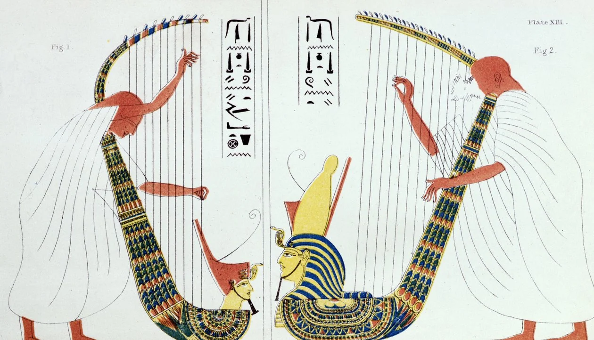

# 1.1 — Contexto de inicio

[⬅ volver al índice del curso](../../README.md)

**Objetivo:** entender por qué la música aparece junto con las primeras civilizaciones y qué rol
social y religioso tenía antes de que existiera siquiera la idea de "compositor".

## Por qué no hay un "inicio" exacto

No existe una fecha de nacimiento de la música. Hay flautas de hueso de buitre y de mamut
encontradas en cuevas de Alemania (Hohle Fels, Geissenklösterle) que tienen entre 35.000 y 40.000
años, de la época del Paleolítico Superior, cuando el Homo sapiens convivía todavía con los
neandertales en Europa. Eso significa que hacer música —soplar un tubo con agujeros afinados a
propósito, no al azar— es una de las actividades humanas más viejas que se conocen, más vieja que
la agricultura, la escritura o la rueda.

Lo que sí podemos fechar con precisión es cuándo la música empieza a dejar **rastro escrito**: ahí
arranca esta lección, en las primeras civilizaciones con escritura, Mesopotamia y Egipto, entre el
3500 a.C. y el 1000 a.C. aproximadamente.

> **Nota:** vas a ver que en este curso, para los períodos más antiguos, hablamos de "cómo vivía la
> sociedad" más que de compositores concretos. Es así porque durante miles de años la música no se
> firmaba: era un oficio colectivo, religioso o cortesano, sin la noción de "autor" que tenemos hoy.

## Mesopotamia: la música como tecnología religiosa

En Sumeria y luego en Babilonia (actual Irak), la música no era entretenimiento: era una
herramienta para comunicarse con los dioses. Los templos tenían músicos de planta, pagados por el
estado-templo, con una jerarquía interna tan formal como la de los sacerdotes. Había instrumentos
de cuerda (el arpa y la lira), de percusión (tambores de marco) y de viento (flautas dobles).

Un dato que suele sorprender: entre las tablillas de arcilla halladas durante las excavaciones de
Leonard Woolley en Ur (sur de Irak, entre 1922 y 1934) hay una con notación cuneiforme que los
especialistas identificaron recién en 1959 como instrucciones de afinación de un instrumento de
cuerda, y
hay una tablilla hurrita (de Ugarit, actual Siria, hacia 1400 a.C.) conocida como el "Himno a
Nikkal" que algunos musicólogos reconstruyeron como una melodía completa, con su letra en honor a
la diosa de la luna Nikkal. Es, probablemente, la pieza musical más antigua del mundo que se puede
"escuchar" hoy en una reconstrucción razonable (aunque la reconstrucción exacta sigue debatida,
porque el sistema de notación cuneiforme todavía no se interpreta con un cien por ciento de
consenso). La vas a encontrar en la guía de escucha de esta fase.

## Egipto: música para la vida y para la eternidad

En Egipto la música acompañaba el trabajo agrícola, las fiestas religiosas, los banquetes de la
nobleza y también los funerales: hay pinturas murales en tumbas (por ejemplo en Saqqara, alrededor
del 2500 a.C.) que muestran arpistas, flautistas y cantantes tocando para el difunto, porque se
creía que la música ayudaba al alma a cruzar hacia la otra vida. Los músicos profesionales tenían
estatus social reconocido, a veces ciegos (hay representaciones de arpistas ciegos, un oficio
respetado para personas con discapacidad visual en esa sociedad). No había, hasta donde se sabe,
un sistema de notación egipcio: la música se transmitía de oído, de maestro a aprendiz, con gestos
de las manos (quironomía) que indicaban si la melodía subía o bajaba.

## Cómo vivía la sociedad: una vida sin "música grabada"

Para entender este período hay que sacarse de la cabeza la idea moderna de música como producto de
consumo. No había discos, ni partituras que cualquiera pudiera comprar, ni la posibilidad de
escuchar la misma canción dos veces exactamente igual. La música:

- Era **ritual**: acompañaba un sacrificio, una coronación, una cosecha, un funeral.
- Era **oral**: se aprendía escuchando y repitiendo, no leyendo.
- Era **funcional**: cada tipo de música tenía un uso específico (de guerra, de trabajo, de duelo,
  de culto) y mezclar esos usos hubiera sido tan raro como poner una marcha militar en un funeral
  hoy.
- Estaba **controlada por el poder**: templos y palacios financiaban a los músicos, así que la
  música "oficial" reflejaba lo que esas instituciones querían transmitir.

## Hechos históricos relevantes

| Hecho | Época aproximada | Por qué importa |
|---|---|---|
| Flautas de hueso del Paleolítico (Hohle Fels) | 35.000-40.000 a.C. | evidencia más antigua de instrumentos musicales fabricados |
| Primeras ciudades-templo en Sumeria | 3500-3000 a.C. | aparecen los primeros músicos profesionales documentados |
| Lira de Ur (tumba real) | ~2500 a.C. | instrumento de cuerda más antiguo conservado físicamente |
| Pinturas de músicos en tumbas egipcias | ~2500-1500 a.C. | documentan el rol social y el prestigio del músico |
| Himno a Nikkal (tablilla de Ugarit) | ~1400 a.C. | pieza musical más antigua con notación que se intentó reconstruir |

## Preguntas de repaso

1. ¿Por qué no se puede hablar de una "fecha de nacimiento" de la música?
2. ¿Qué diferencia hay entre la función de la música en Mesopotamia y en Egipto?
3. ¿Qué es la quironomía y para qué servía en el Egipto antiguo?
4. ¿Por qué el Himno a Nikkal es una pieza tan importante para los historiadores de la música?
5. ¿Qué tres características tenía la música en las civilizaciones antiguas que la hacen tan
   distinta de la música que consumimos hoy?

### Respuestas

1. Porque hacer música (instrumentos afinados a propósito) es anterior incluso a la escritura: las
   flautas de hueso encontradas en Alemania tienen entre 35.000 y 40.000 años, de una época sin
   ningún registro escrito. Lo único que se puede fechar con precisión es cuándo la música empieza
   a dejar rastro escrito, no cuándo "empezó" realmente.
2. En Mesopotamia la música estaba ligada sobre todo al templo y a comunicarse con los dioses, con
   músicos de planta pagados por el estado-templo. En Egipto tenía un uso más amplio: acompañaba el
   trabajo, las fiestas, los banquetes y, de forma muy marcada, los rituales funerarios, porque se
   creía que ayudaba al alma del difunto a pasar a la otra vida.
3. La quironomía era un sistema de gestos con las manos que un director o maestro usaba para
   indicarle a los músicos si la melodía debía subir o bajar, en ausencia de una notación escrita.
   Era, en los hechos, la forma egipcia de "dirigir" sin partitura.
4. Porque es la pieza musical más antigua del mundo de la que existe tanto una melodía como una
   letra, grabada en una tablilla cuneiforme de alrededor de 1400 a.C., y por lo tanto la primera
   vez en la historia que podemos intentar "escuchar" (mediante reconstrucción moderna) cómo sonaba
   realmente una composición antigua, aunque la interpretación exacta de su notación siga
   discutida entre especialistas.
5. Era ritual (ligada a ceremonias específicas), oral (se transmitía escuchando y repitiendo, no
   leyendo partituras) y funcional (cada tipo de música tenía un uso puntual, no era un producto de
   consumo general como hoy).

## Fuentes y para seguir leyendo

- Universidad de Tubinga, hallazgos de flautas paleolíticas en Hohle Fels y Geissenklösterle.
- Anne Kilmer, reconstrucciones del Himno a Nikkal (tablilla hurrita de Ugarit, h-6).
- Pinturas murales de tumbas egipcias en Saqqara y en el Valle de los Nobles (Tebas).

[⬅ volver al índice del curso](../../README.md)
