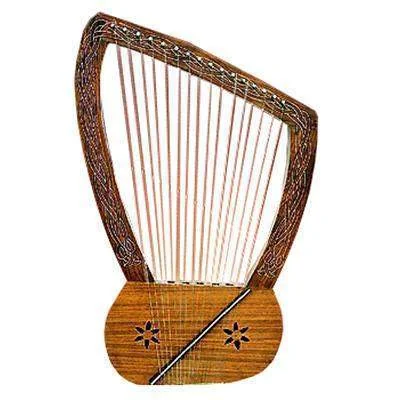
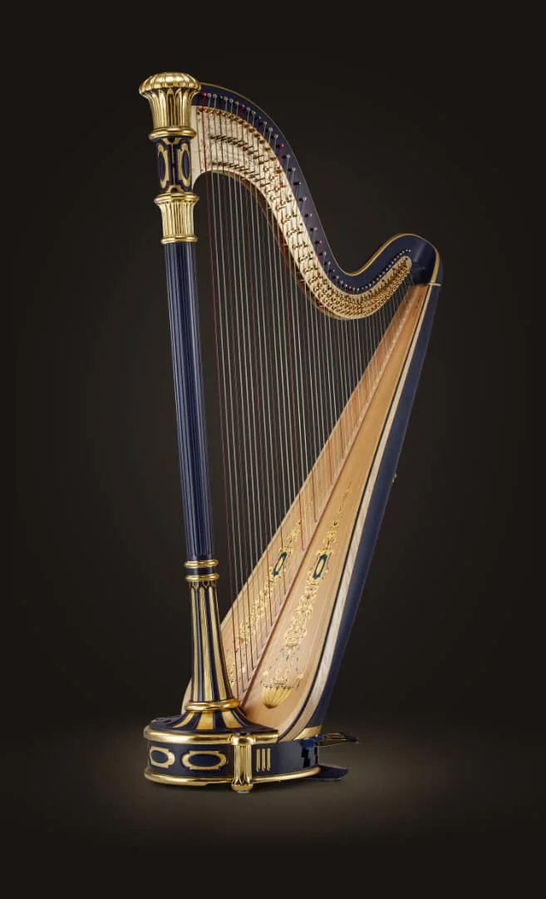
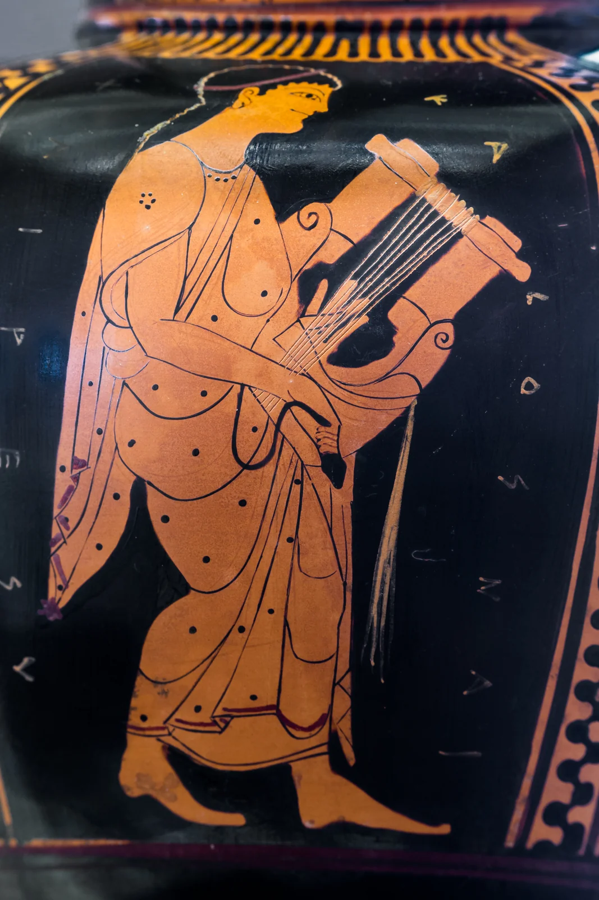
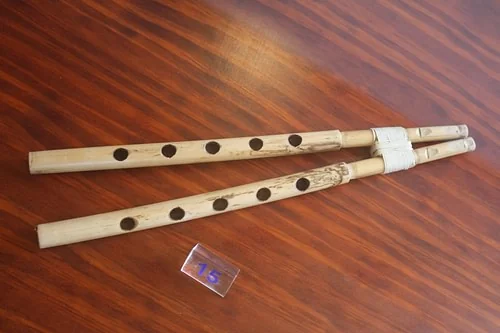
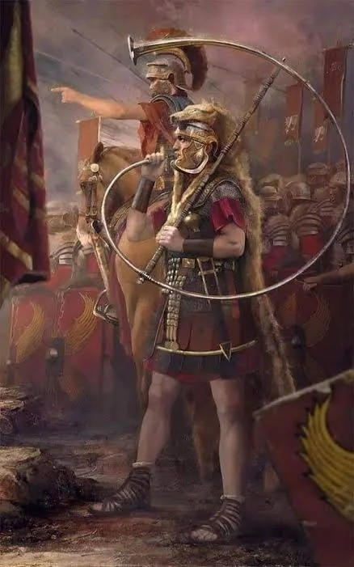
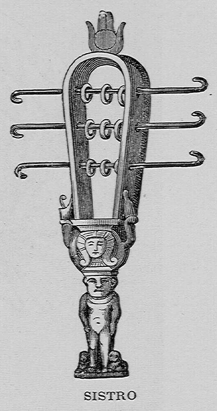

# 1.2 — Instrumentos de la antigüedad

[⬅ volver al índice del curso](../../README.md)

**Objetivo:** conocer los instrumentos principales del mundo antiguo, cómo estaban hechos y qué
estética sonora tenían, explicado para quien nunca tocó un instrumento.

## Cómo pensar un instrumento antiguo

Antes de entrar instrumento por instrumento, conviene tener un mapa simple. Todo instrumento
produce sonido de alguna de estas formas, y esa clasificación (que inventó un musicólogo llamado
Curt Sachs en el siglo XX, pero que sirve igual para instrumentos de hace 4000 años) te va a servir
para todo el curso:

| Familia | Cómo suena | Ejemplos de esta lección |
|---|---|---|
| Cuerda (cordófonos) | una cuerda tensada vibra al pulsarla, frotarla o golpearla | lira, arpa, kithara |
| Viento (aerófonos) | una columna de aire vibra dentro de un tubo | aulos, flauta, buccina |
| Percusión (membranófonos e idiófonos) | un cuero tensado o un cuerpo sólido vibra al golpearlo | tambores de marco, sistro |

## La lira

La lira es el instrumento más representativo de Mesopotamia y luego de Grecia. Imaginate una caja
de resonancia de madera (a veces con forma de animal, como la famosa Lira de Toro de Ur) de la que
salen dos brazos curvos unidos por una barra transversal; entre esa barra y la caja se tensan entre
4 y 11 cuerdas, cada una afinada a una nota distinta. Se toca con los dedos de una mano pulsando
las cuerdas, mientras la otra mano a veces "frena" las cuerdas que no quiere que sigan sonando
(técnica que todavía usan los guitarristas hoy, se llama "apagado").

**Cómo suena:** un sonido cálido, de ataque suave (no es un sonido percusivo y seco como una
guitarra eléctrica), parecido a un arpa pequeña. No tiene trastes ni manera de alterar la altura de
una cuerda en el momento: cada cuerda suena siempre la misma nota, así que la melodía nace de
elegir qué cuerdas pulsar y en qué orden.

## El arpa

Parecida en concepto a la lira pero sin la barra transversal: las cuerdas van directo de un marco
triangular o en forma de arco a la caja de resonancia, con largos distintos para cada cuerda (las
cuerdas más largas dan notas más graves). El Arpa de Ur, hallada en una tumba real de Ur
(Mesopotamia, ~2500 a.C.) y hoy reconstruida en el Museo Británico y el Penn Museum, tenía una caja
decorada con una cabeza de toro de oro y lapislázuli: era, además de instrumento musical, un objeto
de estatus y de prestigio religioso.

**Cómo suena:** más resonante y "abierto" que la lira, porque las cuerdas más largas vibran más
tiempo. Es el antepasado directo del arpa de orquesta que vas a ver en el Romanticismo.

## La kithara griega

Es una lira más grande y más pesada, con una caja de resonancia de madera maciza (no una caparazón
de tortuga como las liras más simples, que también existían en Grecia bajo el nombre de forminge).
La tocaban los profesionales, los llamados "citaristas", de pie, sosteniéndola contra el cuerpo con
una correa. Era el instrumento de la poesía épica cantada y de los concursos musicales
(agones) en los festivales religiosos griegos, como los que se hacían en Delfos.

**Cómo suena:** parecido a la lira pero con más cuerpo y proyección, porque su caja de resonancia
era más grande y más rígida.

## El aulos

Es el instrumento de viento más importante de Grecia, y probablemente el más mal entendido por
quien no sabe de música: se suele traducir como "flauta doble", pero no es una flauta. El aulos
tiene **una lengüeta** en la boquilla (como un oboe o un clarinete moderno), no se sopla
"soplando el aire sobre un filo" como una flauta dulce. Eran dos tubos, uno para cada mano, que el
músico tocaba al mismo tiempo: con uno sostenía una nota como base (como un zumbido continuo) y con
el otro tocaba la melodía.

**Cómo suena:** un sonido nasal, penetrante, mucho más agresivo que una flauta. Los griegos lo
asociaban con Dioniso, el dios del éxtasis y del vino, en contraste con la kithara, asociada a
Apolo, el dios de la razón y el equilibrio. Esa oposición (aulos = pasión descontrolada, kithara =
orden racional) es una de las primeras veces en la historia donde una cultura usa el timbre de un
instrumento como metáfora de una idea filosófica.

## La buccina y el cornu romanos

Roma, más que crear instrumentos propios, adoptó y militarizó los instrumentos griegos y
etruscos. La buccina y el cornu eran grandes trompas de metal enrolladas, usadas en el ejército
romano para dar señales a la distancia (marchar, atacar, retirarse) y en ceremonias públicas.

**Cómo suena:** un sonido grave, metálico, de pocas notas (porque no tenían llaves ni válvulas:
solo podían tocar los armónicos naturales del tubo, parecido a lo que logra hoy un corno sin
pistones). No era un instrumento "melódico" en el sentido moderno, sino una señal sonora, el
antepasado lejanísimo de la trompeta militar.

## El sistro egipcio

Un idiófono de percusión en forma de raqueta con un marco metálico por el que pasan unas varillas
con discos sueltos, que suenan al sacudirlo, parecido a una pandereta pero sin parche. Se usaba casi
exclusivamente en rituales religiosos egipcios, sobre todo en el culto a la diosa Hathor e Isis.

**Cómo suena:** un sonajeo metálico, brillante, sin altura definida (no "afina" una nota concreta,
es puro timbre). Su función no era melódica sino rítmica y ceremonial, para marcar el pulso de una
procesión o ahuyentar espíritus malos, según la creencia egipcia.

## Tabla resumen de estética sonora

| Instrumento | Familia | Sonido en una frase |
|---|---|---|
| Lira | cuerda | cálido, suave, de pocas notas sostenidas |
| Arpa | cuerda | resonante, abierto, notas que se dejan sonar |
| Kithara | cuerda | como la lira pero con más cuerpo y proyección |
| Aulos | viento (lengüeta doble) | nasal, penetrante, casi agresivo |
| Buccina/cornu | viento (metal natural) | grave, metálico, de señal, no melódico |
| Sistro | percusión | sonajeo metálico brillante, rítmico |

## Preguntas de repaso

1. ¿Qué diferencia hay entre un cordófono y un aerófono?
2. ¿Por qué decimos que el aulos "no es una flauta" aunque muchas traducciones lo llamen así?
3. ¿Qué oposición simbólica construyeron los griegos entre el aulos y la kithara?
4. ¿Para qué se usaban la buccina y el cornu en Roma, y por qué no se los puede considerar
   instrumentos "melódicos" en el sentido moderno?
5. ¿Qué tenía de especial el Arpa de Ur, más allá de ser un instrumento musical?

### Respuestas

1. Un cordófono produce sonido por la vibración de una cuerda tensada (lira, arpa, kithara); un
   aerófono lo produce por la vibración de una columna de aire dentro de un tubo (aulos, buccina).
   Es la distinción más básica entre "familias" de instrumentos y se usa para clasificar
   instrumentos de cualquier época, no solo de la antigüedad.
2. Porque una flauta produce sonido por el aire que pasa sobre un filo (sin lengüeta), mientras que
   el aulos tiene una lengüeta en la boquilla, igual que un oboe o un clarinete modernos. Esa
   lengüeta es la que le da su sonido nasal y penetrante, muy distinto al sonido suave de una
   flauta.
3. Lo asociaron a Dioniso, el dios del éxtasis, el vino y la pasión descontrolada, en oposición a
   la kithara, asociada a Apolo, el dios de la razón y el equilibrio. Era una forma de usar el
   timbre de los instrumentos como metáfora de dos formas opuestas de entender la experiencia
   humana: el orden racional contra el impulso emocional.
4. Se usaban como instrumentos de señal: para transmitir órdenes militares a distancia (marchar,
   atacar, retirarse) y en ceremonias públicas. No se los puede considerar melódicos porque, al no
   tener llaves ni válvulas, solo podían producir los armónicos naturales del tubo, es decir, un
   puñado fijo de notas relacionadas entre sí, no cualquier melodía que uno quisiera tocar.
5. Además de ser un instrumento de cuerda funcional, era un objeto de estatus: tenía una caja de
   resonancia decorada con una cabeza de toro de oro y lapislázuli, y se encontró en una tumba real,
   lo que indica que no era un instrumento cualquiera sino una pieza ligada al poder y al prestigio
   religioso de quien lo poseía.

[⬅ volver al índice del curso](../../README.md)
