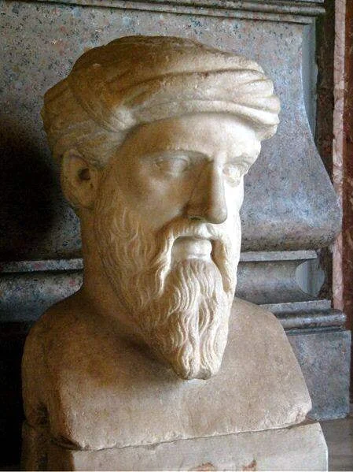
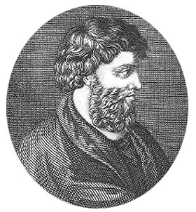

# 1.5 — Teóricos y figuras conocidas

[⬅ volver al índice del curso](../../README.md)

**Objetivo:** conocer a las figuras individuales que sí nos llegaron por nombre de este período,
entendiendo por qué no son "compositores" en el sentido que vas a ver desde la Edad Media.

## Por qué esta lección no tiene biografías de compositores

En las fases siguientes vas a encontrar lecciones dedicadas a un compositor por vez: Bach, Mozart,
Beethoven. En la música antigua eso no es posible, porque el concepto de "compositor individual
cuya obra se conserva y se firma" todavía no existía como institución social. Lo que sí tenemos son
**teóricos**: personas que pensaron y escribieron sobre cómo funciona la música, sin que
necesariamente conozcamos ninguna melodía concreta que hayan compuesto ellos mismos.

## Pitágoras (h. 570-495 a.C.)

Filósofo y matemático de Samos, fundador de una escuela filosófico-religiosa en el sur de Italia.
No escribió ningún tratado musical que haya sobrevivido (de hecho, no se sabe con certeza si
escribió algo en absoluto: casi todo lo que sabemos de él viene de discípulos posteriores). Su
aporte, según la tradición, fue experimental: usando un instrumento llamado monocordio (una sola
cuerda tensada sobre una caja, con un puente móvil para acortar o alargar la parte que vibra),
habría demostrado que los intervalos musicales agradables corresponden a relaciones numéricas
simples entre longitudes de cuerda. Esta idea —que la armonía musical es, en el fondo, matemática—
es probablemente el aporte filosófico más influyente de toda la historia de la música, porque
instala la premisa de que el universo entero (no solo la música) está ordenado según proporciones
armónicas, lo que los pitagóricos llamaban "la música de las esferas": la creencia de que los
planetas, al moverse, producen una armonía inaudible para el oído humano pero matemáticamente
real.

## Aristóxeno de Tarento (h. 375-320 a.C.)

Discípulo de Aristóteles, es el primer teórico musical cuyo texto nos llegó de forma sustancial:
su obra "Elementos de armonía" (Harmonika stoicheia) es el tratado de teoría musical más antiguo
que se conserva casi completo. Aristóxeno discutió abiertamente con la tradición pitagórica: donde
los pitagóricos insistían en que todo intervalo musical debía reducirse a una proporción numérica
exacta, Aristóxeno argumentó que el oído humano, no el número, es el juez final de si un intervalo
suena bien o mal. Esta discusión —¿la música se juzga con matemática o con oído?— va a repetirse,
con otras palabras, muchísimas veces más adelante en este curso (por ejemplo, en el debate entre
afinación "justa" y afinación "temperada" que vas a ver en el Barroco y el Clasicismo).

## Boecio (h. 477-524 d.C.)

Filósofo romano, estadista, consejero del rey ostrogodo Teodorico en Rávena, ejecutado por traición
(una acusación que probablemente fue política) alrededor del año 524. Mientras esperaba su
ejecución en prisión escribió su obra más famosa, "Consolación de la filosofía", pero para esta
lección nos interesa otro de sus libros: "De institutione musica" ("Sobre los fundamentos de la
música"), donde tradujo al latín y organizó de forma sistemática la teoría musical griega
(incluidas las ideas pitagóricas). Boecio clasificó la música en tres tipos: "musica mundana" (la
armonía del cosmos, los planetas), "musica humana" (la armonía interna del cuerpo y el alma
humanos) y "musica instrumentalis" (la música que efectivamente se toca y se escucha, la única de
las tres que percibimos con los oídos). Esta clasificación va a ser estudiada literalmente palabra
por palabra en las universidades medievales durante casi mil años.

## El autor anónimo del Himno a Nikkal

Vale la pena nombrarlo, aunque no tengamos ningún nombre: quien compuso la melodía y la letra de la
tablilla hurrita de Ugarit (lección 1.4) es, hasta donde la arqueología puede confirmar, el
"compositor" más antiguo del que tenemos una obra reconstruible, aunque jamás vayamos a saber quién
fue. Es un buen recordatorio de que, durante la inmensa mayoría de la historia de la música, la
obra sobrevivió y el nombre de quien la hizo, no.

## Preguntas de repaso

1. ¿Por qué esta lección habla de "teóricos" y no de "compositores"?
2. ¿Qué habría demostrado Pitágoras usando un monocordio, y por qué esa idea fue tan influyente
   más allá de la música?
3. ¿En qué se diferencia la postura de Aristóxeno de la postura pitagórica sobre cómo juzgar un
   intervalo musical?
4. ¿Cuáles son los tres tipos de música que distingue Boecio en "De institutione musica"?
5. ¿Por qué el caso del Himno a Nikkal es un buen ejemplo de la relación entre obra y autor en la
   música antigua?

### Respuestas

1. Porque el concepto de "compositor individual" cuya obra se conserva, se firma y se le atribuye
   a una persona concreta todavía no existía como institución social en este período: lo que
   tenemos son personas que pensaron y escribieron sobre cómo funciona la música en términos
   generales, no autores de piezas concretas identificadas.
2. Habría demostrado que los intervalos musicales agradables corresponden a relaciones numéricas
   simples entre longitudes de cuerda (por ejemplo, la mitad de una cuerda da la misma nota una
   octava más arriba). Fue influyente más allá de la música porque instaló la idea de que el
   universo entero está ordenado según proporciones armónicas, la llamada "música de las esferas",
   una creencia que influyó en la filosofía y la cosmología durante siglos.
3. Los pitagóricos sostenían que todo intervalo musical debía reducirse a una proporción numérica
   exacta: el número era el juez. Aristóxeno, en cambio, argumentó que es el oído humano, y no el
   cálculo matemático, el que finalmente decide si un intervalo suena bien o mal. Es el primer
   gran debate documentado entre un criterio matemático y un criterio perceptivo en la historia de
   la teoría musical.
4. Distingue la "musica mundana" (la armonía del cosmos y los planetas), la "musica humana" (la
   armonía interna del cuerpo y el alma de una persona) y la "musica instrumentalis" (la música que
   efectivamente se toca y se escucha, la única de las tres que se percibe con los oídos).
5. Porque muestra que, aunque la obra (la melodía y la letra) logró sobrevivir casi 3400 años
   gracias a estar grabada en una tablilla de arcilla, el nombre de la persona que la compuso se
   perdió para siempre. Es representativo de cómo funcionaba la autoría musical durante la
   inmensa mayoría de la historia: la obra podía trascender, pero casi nunca el autor individual.
