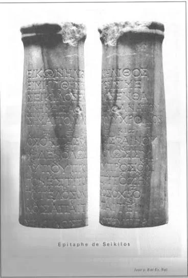

# 1.6 — Obras clave y guía de escucha

[⬅ volver al índice del curso](../../README.md)

**Objetivo:** tener una lista concreta de qué buscar y escuchar para anclar todo lo visto en la
fase a sonido real (o a la reconstrucción más cercana posible al sonido real).

## Cómo usar esta guía

A diferencia de las fases siguientes, en música antigua no hay grabaciones originales: todo lo que
vas a poder escuchar es una **reconstrucción moderna**, hecha por musicólogos e intérpretes
especializados en música antigua a partir de instrumentos replicados y, cuando existe, de
notación original. Buscá estos nombres en YouTube o en tu plataforma de streaming; muchos grupos
especializados en música antigua (como Ensemble De Organographia o el musicólogo Richard Dumbrill)
tienen grabaciones disponibles.

## 1. Himno a Nikkal (tablilla hurrita de Ugarit, h. 1400 a.C.)

Buscá: "Hurrian Hymn to Nikkal" o "Hymn No. 6, Ugarit". Es la pieza con letra y melodía más antigua
reconstruida del mundo (lección 1.4). Escuchá la reconstrucción de Anne Kilmer (hay versiones con
lira o con arpa). Prestá atención a que la melodía se mueve en intervalos pequeños, sin grandes
saltos: es un buen ejemplo de cómo sonaba una melodía vocal con acompañamiento de cuerda en
Mesopotamia, aunque recordá que la interpretación exacta sigue debatida.

## 2. Epitafio de Seikilos (grabado en una estela funeraria, Turquía, siglo I o II d.C.)

Buscá: "Seikilos Epitaph". A diferencia del Himno a Nikkal, esta es una pieza griega (no hurrita) y
su notación es mucho más clara y menos discutida, porque usa el sistema de notación alfabética
griego, que se entiende bien. Es, por eso, la melodía completa más antigua del mundo sobre la que
los musicólogos tienen **consenso casi total** respecto de cómo sonaba. La letra, grabada en la
piedra junto con la música, dice en español algo como: "Mientras vivas, brillá; no te aflijas por
nada en absoluto. La vida es corta, y el tiempo exige su tributo." Es una pieza corta, melancólica
pero serena, cantada originalmente con acompañamiento de kithara.

## 3. Primer Himno Delfico (Himno a Apolo, h. 128 a.C.)

Buscá: "First Delphic Hymn" o "Himno a Apolo de Atenaios". Grabado en piedra en el templo de
Apolo en Delfos, es un ejemplo de música de agón (lección 1.3 y 1.4): una pieza compuesta para una
competencia religiosa oficial. Escuchalo prestando atención al carácter solemne y ceremonial, muy
distinto a la intimidad del Epitafio de Seikilos.

## 4. Reconstrucciones de aulos

Buscá: "ancient Greek aulos reconstruction" o el trabajo del músico e investigador Barnaby Brown,
que construye y toca réplicas de aulos basadas en fragmentos arqueológicos hallados en Grecia y
Egipto. Escuchá el timbre nasal y penetrante del instrumento (lección 1.2): es muy distinto a
cualquier instrumento de viento moderno y te va a ayudar a entender por qué los griegos lo asociaban
con el éxtasis dionisíaco.

## 5. Reconstrucciones de la Lira de Ur

Buscá: "Lyres of Ur" o "Golden Lyre of Ur reconstruction". El Museo Británico y la Universidad de
Pensilvania (Penn Museum) tienen réplicas construidas y grabadas de las liras encontradas en las
tumbas reales de Ur (lección 1.4). Es la forma más directa de escuchar el timbre cálido y suave
descripto en la lección 1.2.

## Tabla resumen

| Obra | Origen | Qué escuchar |
|---|---|---|
| Himno a Nikkal | hurrita, Ugarit, ~1400 a.C. | melodía vocal reconstruida, con intervalos chicos |
| Epitafio de Seikilos | griego, ~siglo I-II d.C. | melodía con mayor consenso de reconstrucción |
| Primer Himno Délfico | griego, ~128 a.C. | música religiosa/ceremonial de competencia |
| Reconstrucciones de aulos | griego | timbre nasal, penetrante, lengüeta doble |
| Reconstrucciones de la Lira de Ur | mesopotámico, ~2500 a.C. | timbre cálido de cuerda antigua |

## Preguntas de repaso

1. ¿Por qué en esta fase nunca vas a escuchar una "grabación original" sino siempre una
   reconstrucción?
2. ¿Qué diferencia de certeza hay entre la reconstrucción del Himno a Nikkal y la del Epitafio de
   Seikilos?
3. ¿Qué dice, en resumen, la letra del Epitafio de Seikilos?
4. ¿Para qué tipo de evento se compuso el Primer Himno Délfico?

### Respuestas

1. Porque la música antigua no se grababa en ningún soporte que conserve el sonido (como sí pasa
   desde finales del siglo XIX con el fonógrafo): todo lo que tenemos son notaciones en piedra o
   arcilla, instrumentos físicos hallados en excavaciones, y descripciones escritas, a partir de
   los cuales los musicólogos de hoy construyen la mejor aproximación posible a cómo sonaba.
2. El Himno a Nikkal está escrito en un sistema de notación cuneiforme hurrita que no se interpreta
   con consenso total entre los especialistas, así que su reconstrucción sigue siendo, en parte,
   una hipótesis razonada. El Epitafio de Seikilos, en cambio, usa notación alfabética griega, que
   se entiende mucho mejor, por lo que existe prácticamente consenso académico sobre cómo sonaba
   esa melodía.
3. Dice, en esencia, que mientras uno esté vivo hay que brillar y no afligirse por nada, porque la
   vida es corta y el tiempo cobra su tributo: es un mensaje de disfrutar el presente frente a lo
   breve de la existencia, grabado como epitafio en una tumba.
4. Se compuso para un agón religioso (una competencia musical oficial) en honor a Apolo en el
   templo de Delfos, el mismo tipo de evento descripto en la lección 1.4 sobre los Juegos Píticos.

[⬅ volver al índice del curso](../../README.md)
