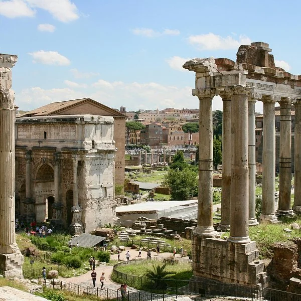

# 1.7 — Fin del período

[⬅ volver al índice del curso](../../README.md)

**Objetivo:** entender cómo y por qué termina la música antigua y qué cambios históricos abren la
puerta a la Edad Media.

## No hay un corte limpio

Así como no hay fecha de inicio para la música antigua, tampoco hay un día exacto en que "termina"
y "empieza" la Edad Media. Lo que sí hay es un conjunto de procesos históricos, entre los siglos
III y VI d.C., que transforman completamente el marco social, religioso y político en el que se
hace música en Europa y el Mediterráneo, y que hacen que la música de la Antigüedad clásica dé paso
a algo distinto.

## La crisis y caída del Imperio Romano de Occidente

Entre los siglos III y V d.C., el Imperio Romano de Occidente entra en una crisis económica,
política y militar profunda: invasiones de pueblos germánicos (visigodos, vándalos, ostrogodos),
inflación, fragmentación del poder central. En el año 476 d.C. el último emperador romano de
Occidente, Rómulo Augústulo, es depuesto por el jefe militar germánico Odoacro, un hecho que la
historiografía tradicional marca como el fin formal del Imperio Romano de Occidente (el Imperio
Romano de Oriente, con capital en Constantinopla, va a seguir existiendo casi mil años más, hasta
1453).

Esto importa para la música porque desaparecen las instituciones que sostenían la vida musical
romana: el circo, el teatro público financiado por el estado, las escuelas de música esclavas de
las casas aristocráticas. La infraestructura que hacía posible la música romana se desarma junto
con el estado que la financiaba.

## El ascenso del cristianismo como religión dominante

En el 313 d.C. el emperador Constantino promulga el Edicto de Milán, que establece la tolerancia
religiosa hacia el cristianismo (hasta entonces perseguido en el Imperio). En el 380 d.C. el
emperador Teodosio lo convierte, por el Edicto de Tesalónica, en la religión oficial del Imperio.
Este cambio es, para la historia de la música, tan importante como la caída política de Roma:
a partir de este momento, la institución que va a financiar, organizar y conservar la música en
Europa occidental durante los siguientes mil años no va a ser el estado ni la aristocracia privada,
sino **la Iglesia**.

El cristianismo trae consigo, además, una actitud nueva y bastante sospechosa hacia la música
instrumental y el placer sensorial de los instrumentos: muchos padres de la Iglesia (como San
Agustín, siglo IV-V) desconfiaban de la música instrumental por considerarla ligada al paganismo y
a los placeres mundanos, y preferían el canto vocal, sin acompañamiento, como la forma "pura" de
alabar a Dios. Esa preferencia por la voz humana sin instrumentos va a ser la base del canto
gregoriano que vas a estudiar en la Fase 2.

## Boecio, el puente consciente hacia la Edad Media

Como vimos en la lección 1.5, Boecio (h. 477-524 d.C.) escribe "De institutione musica" ya en el
reino ostrogodo de Italia, después de la caída formal de Roma, mientras trabaja como funcionario de
un rey germánico que gobierna sobre territorio romano. Su obra no mira hacia adelante inventando
algo nuevo: mira hacia atrás, rescatando y traduciendo al latín la teoría musical griega para que
no se pierda. En ese sentido, Boecio es la figura que, de forma literal, carga el conocimiento
musical de la Antigüedad sobre sus hombros y lo entrega a la Edad Media que viene.

## Lo que se pierde y lo que sigue

- **Se pierde** (o se reduce drásticamente): la música instrumental profana ligada al estado, el
  teatro musical griego y romano tal como existía, las competencias musicales públicas tipo agón,
  la clase de músicos profesionales esclavos de las casas aristocráticas.
- **Sigue** (transformado): la teoría musical griega, sobre todo a través de Boecio, va a seguir
  siendo estudiada; la práctica de cantar poesía o textos sagrados con una melodía va a continuar,
  pero ahora dentro del marco de la liturgia cristiana; y el prestigio social y religioso de la
  música, que ya existía en Mesopotamia y Egipto, se traslada ahora a la figura del monje y del
  clérigo que canta en la iglesia.

## El contexto histórico más amplio: por qué este cambio es tan brusco

Vale la pena un paso atrás: durante toda la fase 1 viste una música ligada al **poder estatal**
(templos-estado en Mesopotamia, faraones en Egipto, polis y agones en Grecia, legión y circo en
Roma). Lo que pasa entre los siglos III y VI d.C. es que ese poder estatal centralizado se
desintegra en Europa occidental (no en Oriente, donde Constantinopla sigue siendo un imperio
fuerte), y en su lugar aparece un mosaico de reinos germánicos más chicos, más pobres y más
inestables. La única institución que logra sobrevivir a ese desorden con una organización
coherente, con sus propios edificios (monasterios, catedrales), su propia jerarquía (obispos,
abades) y su propia red de comunicación en toda Europa (la correspondencia entre monasterios, el
latín como lengua común) es la Iglesia católica. Por eso, cuando en la Fase 2 veas que "la Iglesia
es el centro de la vida musical medieval", no es una casualidad ni una imposición arbitraria: es
la consecuencia directa de ser la única institución europea que sobrevivió intacta a la caída de
Roma.

## Preguntas de repaso

1. ¿Qué evento se usa convencionalmente para marcar el fin del Imperio Romano de Occidente, y en
   qué año ocurre?
2. ¿Por qué la caída de Roma afecta directamente a la infraestructura de la vida musical?
3. ¿Qué actitud tenían muchos padres de la Iglesia, como San Agustín, hacia la música instrumental,
   y qué consecuencia tuvo esa actitud?
4. ¿Por qué se dice que Boecio es un puente "consciente" hacia la Edad Media y no solo un teórico
   más?
5. ¿Por qué la Iglesia, y no ninguna otra institución, termina siendo el centro de la vida musical
   europea durante la Edad Media?

### Respuestas

1. Se usa la deposición del último emperador romano de Occidente, Rómulo Augústulo, por el jefe
   militar germánico Odoacro, en el año 476 d.C. Es una fecha convencional, no un corte absoluto,
   pero es la que marca la historiografía tradicional.
2. Porque las instituciones que sostenían la música romana (el circo y el teatro financiados por el
   estado, las escuelas de música esclavas de las casas aristocráticas) dependían de un estado
   central fuerte con recursos para financiarlas. Cuando ese estado se desintegra, esa
   infraestructura se desarma con él.
3. Desconfiaban de la música instrumental porque la asociaban al paganismo y a los placeres
   mundanos, y preferían el canto vocal sin acompañamiento como forma "pura" de alabar a Dios. Esa
   preferencia va a ser la base directa del canto gregoriano, monofónico y sin instrumentos, que
   vas a ver en la Fase 2.
4. Porque, a diferencia de un teórico que simplemente describe su propia época, Boecio escribe
   "De institutione musica" ya después de la caída formal de Roma, con el propósito explícito de
   traducir y rescatar la teoría musical griega para que no se pierda, entregándola de forma
   deliberada a la cultura que viene después.
5. Porque, mientras el poder estatal romano se fragmentaba en Europa occidental en un mosaico de
   reinos germánicos inestables, la Iglesia católica fue la única institución que conservó una
   organización coherente en todo el continente (edificios propios, jerarquía propia, una lengua
   común en latín), lo que le permitió ser la única estructura capaz de financiar y organizar la
   vida musical de forma sostenida.

[⬅ volver al índice del curso](../../README.md)
