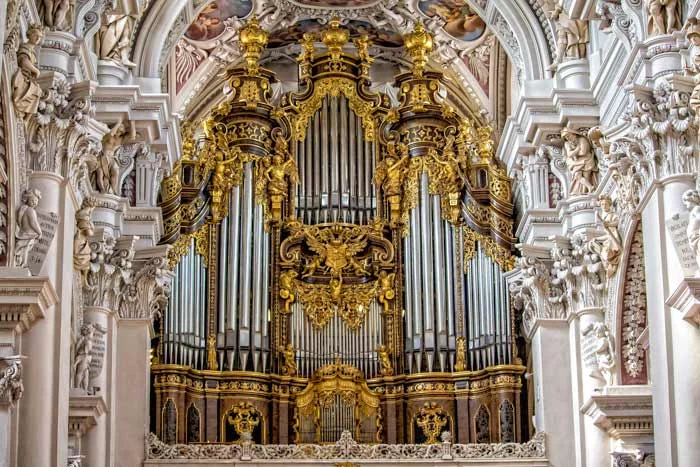
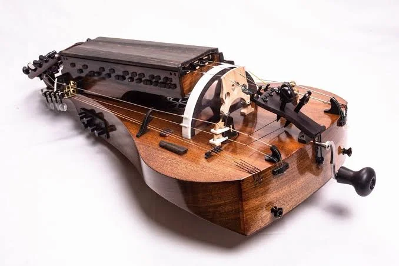
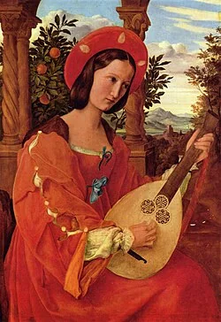
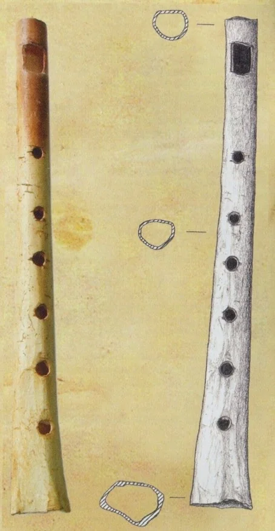
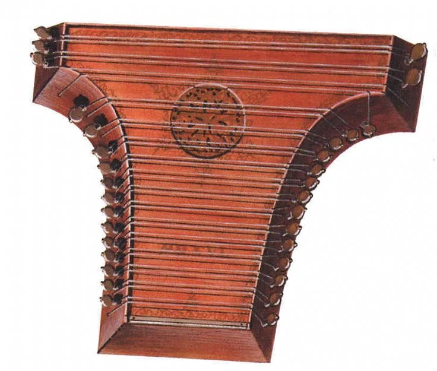
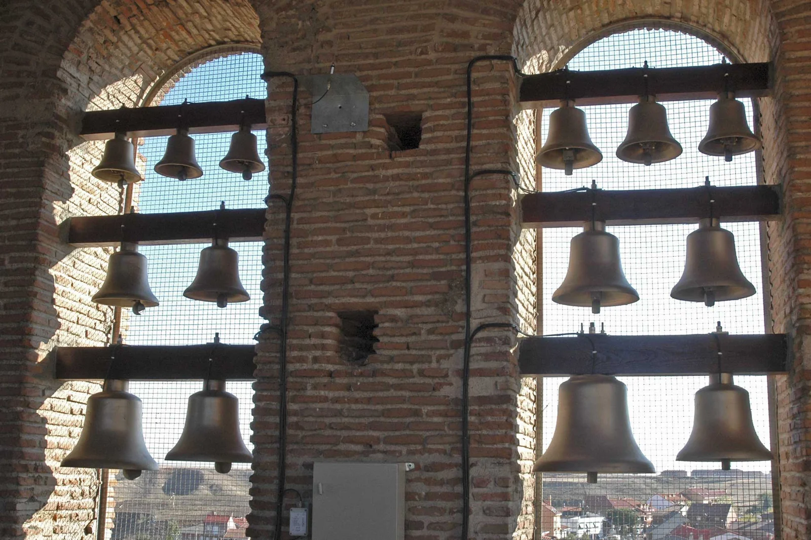

# 2.2 — Instrumentos medievales

[⬅ volver al índice del curso](../../README.md)

**Objetivo:** conocer los instrumentos principales de la Edad Media, cómo funcionan físicamente y
qué estética sonora tienen, explicado para quien no sabe de música.

## El órgano, el gran instrumento institucional

El órgano de tubos (aire que pasa por tubos de distinto largo, cada uno afinado a una nota, con
teclas que abren el paso del aire) es el instrumento medieval más importante desde el punto de
vista institucional. Ya existía en versión hidráulica en la Antigüedad (el hydraulis romano,
lección 1.3), pero en la Edad Media se vuelve el instrumento característico de las catedrales. Un
hito notable: en el año 757 d.C. el emperador bizantino Constantino V le regaló un órgano al rey
franco Pipino el Breve, lo que introdujo el instrumento en Europa occidental con fuerza. Para el
siglo X ya hay catedrales (como la de Winchester, en Inglaterra) con órganos enormes, que
necesitaban varias personas bombeando aire con fuelles para poder sonar.

**Cómo suena:** un sonido sostenido, que no se apaga mientras se mantenga la tecla presionada y
haya aire (a diferencia de una cuerda pulsada, que se apaga sola), y que puede sonar muy grave y
poderoso en tubos grandes o muy agudo y fino en tubos chicos. Es el instrumento que mejor "llena"
el espacio enorme y resonante de una catedral de piedra.

## La vihuela de rueda (zanfona)

Un instrumento de cuerda poco intuitivo para quien nunca lo vio: en vez de pulsarse o frotarse con
un arco, las cuerdas se hacen vibrar con una rueda de madera que gira constantemente, accionada por
una manivela que el músico da vuelta con una mano, mientras con la otra mano aprieta teclas que
acortan la longitud vibrante de una de las cuerdas (la cuerda "melódica"), de forma parecida a como
un dedo acorta una cuerda de guitarra en un traste. Las demás cuerdas suenan siempre igual, como un
"zumbido" de fondo continuo (ese zumbido se llama "bordón").

**Cómo suena:** un sonido continuo y zumbante, parecido en espíritu a una gaita (de hecho ambos
instrumentos usan el mismo concepto de bordón constante), muy usado en música de danza y en
contextos populares, aunque también llegó a usarse en contextos monásticos para enseñar teoría
musical a los novicios, porque permite "ver" físicamente, con las teclas, cómo se relacionan los
intervalos.

## El laúd

De origen árabe (el oud), llegó a Europa a través de la presencia musulmana en la península
ibérica a partir del siglo VIII. Tiene una caja de resonancia en forma de pera cortada a la mitad,
un mástil corto con trastes (en versiones posteriores) y cuerdas dobles que se pulsan con los
dedos o con una púa.

**Cómo suena:** un sonido cálido y relativamente suave, parecido en espíritu a una guitarra
acústica moderna pero más "redondo" y menos brillante en los agudos. Fue el instrumento favorito de
la música cortesana y de los trovadores para acompañar canciones de amor.

## La flauta dulce y el caramillo

Instrumentos de viento sin lengüeta: el aire se sopla contra un filo biselado dentro de la
boquilla, y la melodía se hace tapando y destapando agujeros con los dedos. El caramillo (o
"pipe", en inglés) a veces se tocaba con una sola mano mientras con la otra el músico tocaba un
tamboril, para poder acompañar una danza tocando los dos instrumentos al mismo tiempo.

**Cómo suena:** un sonido claro, suave, sin la agresividad del aulos griego de la lección 1.2 (que
sí tenía lengüeta). Es el antepasado directo de la flauta dulce que todavía se usa hoy en la
educación musical escolar.

## El salterio

Una caja de resonancia plana y trapezoidal con muchas cuerdas tensadas sobre ella, que se pulsan
con los dedos o con pequeños martillos (como un antepasado muy lejano del piano, aunque sin
mecanismo de teclas: cada cuerda se golpea o se pulsa directamente). Era común en ambientes
monásticos y cortesanos.

**Cómo suena:** un sonido brillante y resonante, parecido a un arpa acostada horizontalmente, con
mucha riqueza armónica porque las cuerdas suenan por simpatía entre ellas.

## Las campanas y el carillón

Las campanas de iglesia, además de marcar las horas y convocar a la misa, se usaron desde el
siglo IX como instrumento musical organizado: hay registros de conjuntos de varias campanas
afinadas a distintas notas para tocar melodías sencillas (lo que luego se desarrolla en el
carillón).

**Cómo suena:** un sonido metálico, con mucha resonancia posterior (el sonido sigue vibrando
mucho después del golpe) y una presencia sonora enorme, capaz de escucharse a kilómetros de
distancia en una ciudad medieval.

## Tabla resumen de estética sonora

| Instrumento | Familia | Sonido en una frase |
|---|---|---|
| Órgano de tubos | viento (mecánico) | sostenido, poderoso, llena el espacio de una catedral |
| Vihuela de rueda | cuerda (frotada por rueda) | continuo, zumbante, con bordón constante |
| Laúd | cuerda (pulsada) | cálido, suave, redondo, de origen árabe |
| Flauta dulce/caramillo | viento (sin lengüeta) | claro, suave, sin agresividad |
| Salterio | cuerda (pulsada/golpeada) | brillante, resonante, como un arpa horizontal |
| Campanas | percusión metálica | metálico, de larga resonancia, audible a gran distancia |

## Preguntas de repaso

1. ¿Por qué el órgano de tubos se convierte en el instrumento institucional por excelencia de la
   Edad Media?
2. ¿Cómo produce sonido la vihuela de rueda, y qué es el "bordón"?
3. ¿De dónde proviene el laúd y cómo llegó a Europa?
4. ¿En qué se diferencia físicamente la flauta dulce del aulos griego de la Fase 1?
5. ¿Por qué se dice que las campanas tenían una presencia sonora comparable a la de un instrumento
   musical "institucional"?

### Respuestas

1. Porque es el instrumento que mejor se adapta al espacio enorme y resonante de una catedral de
   piedra: produce un sonido sostenido y poderoso capaz de llenar ese volumen, y además requería
   una inversión de recursos (construcción, mantenimiento, personas para bombear los fuelles) que
   solo una institución como la Iglesia podía sostener de forma regular.
2. Produce sonido mediante una rueda de madera que gira constantemente (accionada por una manivela)
   y hace vibrar las cuerdas por fricción continua, mientras una mano aprieta teclas que acortan la
   cuerda melódica. El "bordón" es el zumbido constante de las cuerdas que no se acortan, que suena
   todo el tiempo como fondo armónico fijo mientras se toca la melodía.
3. Proviene del oud árabe y llegó a Europa a través de la presencia musulmana en la península
   ibérica a partir del siglo VIII, desde donde se difundió hacia el resto de Europa occidental.
4. El aulos griego tenía una lengüeta en la boquilla (como un oboe), lo que le daba un sonido
   nasal y penetrante. La flauta dulce, en cambio, no tiene lengüeta: el sonido se produce por el
   aire soplado contra un filo biselado dentro de la boquilla, lo que le da un timbre mucho más
   suave y claro.
5. Porque, además de marcar las horas y convocar a misa, se organizaban en conjuntos de varias
   campanas afinadas para tocar melodías, con un sonido metálico de gran resonancia capaz de
   escucharse a kilómetros de distancia, lo que las convertía en una forma de comunicación musical
   pública a escala de toda una ciudad, algo que ningún otro instrumento de la época podía lograr.

[⬅ volver al índice del curso](../../README.md)
