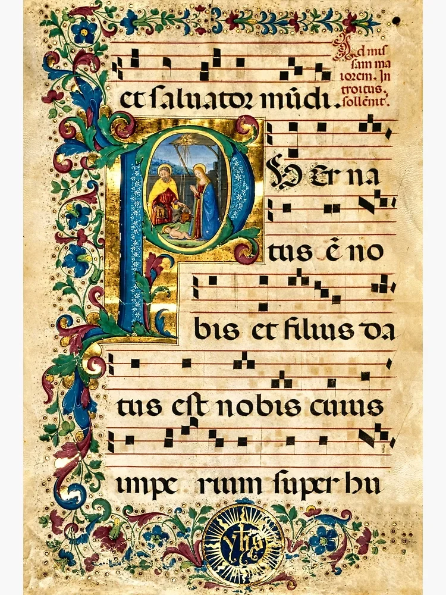

# 2.3 — La música del período

[⬅ volver al índice del curso](../../README.md)

**Objetivo:** entender cómo suena y cómo está construida la música medieval —monofonía, canto
gregoriano, modos eclesiásticos— con explicaciones pensadas para quien no sabe de música.

## Monofonía: una sola línea de melodía

El concepto más importante para entender la música medieval, sobre todo hasta el siglo XII, es la
**monofonía**: toda la música consiste en una única línea melódica, cantada o tocada al mismo
tiempo por todos los que participan, sin ninguna otra voz o instrumento haciendo algo distinto en
simultáneo (ni armonía, ni una segunda melodía, ni acordes). Si escuchás un canto gregoriano de un
coro de monjes, todos están cantando exactamente la misma melodía al mismo tiempo, quizás algunos
una octava más arriba o más abajo según el rango de su voz, pero es, en esencia, una sola línea.
Esto va a cambiar de forma radical a partir del siglo XII con la aparición de la polifonía
(lección 2.4), pero hay que entender bien la monofonía primero porque es la base de todo lo que
viene.

Para alguien acostumbrado a la música de hoy (donde casi siempre hay varios instrumentos tocando
cosas distintas al mismo tiempo: batería, bajo, guitarra, voz), escuchar música puramente monofónica
puede sonar "desnuda" o incompleta. No lo es: es una estética sonora distinta, centrada por completo
en el movimiento de una sola línea melódica, parecida en espíritu a escuchar a una sola persona
recitando un poema con una inflexión musical, sin ningún acompañamiento.

## El canto gregoriano

Es el repertorio de cantos monofónicos en latín usados en la liturgia católica, consolidado
aproximadamente entre los siglos VI y IX. El nombre viene del papa Gregorio I ("Gregorio Magno",
que gobernó entre 590 y 604), aunque hoy los historiadores saben que la atribución directa a él es
en gran parte legendaria: el repertorio se fue formando durante varios siglos, combinando
tradiciones de canto de distintas regiones (Roma, la Galia franca), y recién se estandarizó y se
le dio ese nombre en la época del emperador Carlomagno (hacia el 800), que impulsó políticamente
que todo su imperio usara el mismo repertorio de canto, como forma de unificación religiosa y
cultural.

**Cómo suena:** voces (originalmente solo masculinas, monjes o clérigos) cantando sin ningún
instrumento, en latín, con una melodía fluida que sube y baja de forma suave, sin un pulso
rítmico marcado como el de una canción pop (no hay "batería" marcando el tiempo: el ritmo sigue el
flujo natural del texto latino que se está cantando). Es, probablemente, el sonido que la mayoría
de la gente asocia instintivamente con "música medieval" aunque nunca haya estudiado el tema.

## Los modos eclesiásticos

Así como Grecia tenía sus modos (lección 1.3), la Edad Media desarrolla su propio sistema de
modos para organizar las melodías del canto gregoriano: el dorio, el frigio, el lidio, el
mixolidio (y sus variantes "hipo-"). Como mencionamos en la Fase 1, los teóricos medievales
tomaron estos nombres de Grecia pero los aplicaron de forma distinta a la original griega (un error
de transmisión histórica que, paradójicamente, es el sistema que terminó influyendo en toda la
música occidental posterior, incluida buena parte de la música popular y el jazz de hoy).

La forma más simple de entender un modo eclesiástico, sin tecnicismos: pensalo como una receta de
qué notas blancas de un piano usar (si tocaras solo las teclas blancas) empezando y terminando
siempre en una nota específica llamada "final". Cada modo "final" distinto le da un color emocional
distinto a la melodía, de la misma forma en que hoy distinguís instintivamente una canción en escala
mayor (más "alegre") de una en escala menor (más "triste"), aunque nadie te explique la teoría.

## Guido d'Arezzo y la revolución del pentagrama

Alrededor del año 1025, el monje benedictino Guido d'Arezzo resuelve uno de los problemas más
grandes de la música medieval: hasta entonces, la notación musical (los llamados "neumas", ver
lección 2.4) solo indicaba de forma aproximada si una melodía subía o bajaba, pero no decía con
precisión exacta qué nota tocar. Guido inventa el sistema de líneas horizontales (el antecesor
directo del pentagrama moderno de 5 líneas, aunque el suyo tenía 4) donde cada línea y cada espacio
representa una nota específica, de forma que cualquier cantante que supiera leer el sistema podía
aprender una melodía completamente nueva **sin haberla escuchado nunca antes**, solo leyéndola.
Esto parece obvio hoy, pero fue una revolución comparable, en su época, a la invención de la
imprenta para la literatura: por primera vez la música se podía transmitir con precisión exacta sin
depender de la memoria oral de un maestro.

Guido también inventó el sistema de solfeo con sílabas (ut-re-mi-fa-sol-la, el antecesor directo
del do-re-mi-fa-sol-la-si que cualquiera reconoce hoy), tomando las sílabas iniciales de un himno
latino a San Juan Bautista ("Ut queant laxis, resonare fibris..."). Si alguna vez cantaste
"do-re-mi" en la escuela, estás usando, con una pequeña modificación posterior, un sistema que
inventó un monje italiano hace casi mil años.

## Preguntas de repaso

1. ¿Qué significa que la música medieval, sobre todo hasta el siglo XII, sea "monofónica"?
2. ¿Por qué la atribución del canto gregoriano al papa Gregorio I es, en gran parte, legendaria?
3. ¿Qué rol jugó el emperador Carlomagno en la estandarización del canto gregoriano?
4. ¿Cómo describirías el sonido del canto gregoriano a alguien que nunca lo escuchó?
5. ¿Qué problema concreto resolvió Guido d'Arezzo con su sistema de líneas, y por qué fue tan
   importante?
6. ¿De dónde viene el sistema "do-re-mi" que usamos hoy?

### Respuestas

1. Significa que toda la música consiste en una única línea melódica cantada o tocada al mismo
   tiempo por todos los participantes, sin ninguna otra voz o instrumento haciendo algo distinto
   en simultáneo: no hay armonía ni una segunda melodía superpuesta, solo una línea.
2. Porque el repertorio del canto gregoriano se formó en realidad durante varios siglos (entre el
   VI y el IX aproximadamente), combinando tradiciones de canto de distintas regiones de Europa, y
   recién se estandarizó y se le dio ese nombre bastante después de la muerte de Gregorio I, en
   tiempos de Carlomagno. No existe evidencia de que Gregorio I haya compuesto o siquiera
   organizado personalmente ese repertorio.
3. Impulsó, por motivos de unificación religiosa y cultural de su imperio, que todos los
   territorios bajo su gobierno usaran el mismo repertorio de canto litúrgico, en lugar de que cada
   región mantuviera sus propias tradiciones locales de canto. Esa estandarización política, hacia
   el año 800, es lo que le dio al repertorio su forma consolidada y su nombre.
4. Voces, originalmente solo masculinas, cantando en latín sin ningún instrumento, con una melodía
   fluida que sube y baja suavemente, sin un pulso rítmico marcado: el ritmo sigue el flujo natural
   del texto latino en lugar de un compás fijo como el de una canción popular moderna.
5. Resolvió el problema de que la notación musical anterior (los neumas) solo indicaba de forma
   aproximada si una melodía subía o bajaba, sin decir con precisión qué nota tocar. Su sistema de
   líneas horizontales permitió que un cantante leyera y aprendiera una melodía completamente nueva
   sin haberla escuchado nunca antes, lo que fue una revolución en la forma de transmitir música
   porque ya no dependía exclusivamente de la memoria oral de un maestro.
6. Viene de un sistema de solfeo con sílabas (ut-re-mi-fa-sol-la) que inventó el mismo Guido
   d'Arezzo, tomando las sílabas iniciales de las frases de un himno latino a San Juan Bautista. Con
   el tiempo "ut" se cambió por "do" y se agregó "si", dando el sistema do-re-mi-fa-sol-la-si que
   se usa hoy.

[⬅ volver al índice del curso](../../README.md)
