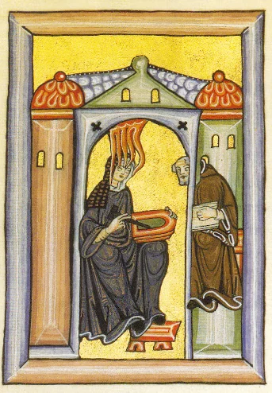

# 2.6 — Hildegard de Bingen

[⬅ volver al índice del curso](../../README.md)

**Objetivo:** conocer la vida y la obra de Hildegard de Bingen, la primera compositora de la
historia de la música occidental identificada por nombre con un catálogo de obra sustancial.

## Vida

Hildegard de Bingen nació en 1098 en Bermersheim, en la región del Rin, en lo que hoy es Alemania,
en una familia noble. A los 8 años fue entregada, como era costumbre en familias nobles con muchos
hijos, al cuidado religioso de una reclusa (una mujer que vivía encerrada en una celda dedicada por
completo a la oración) y luego, a los 14 o 15 años, ingresó formalmente como monja benedictina en
el monasterio de Disibodenberg. En 1136 fue elegida superiora (magistra) de la comunidad de monjas
del monasterio, y en 1150 fundó su propio monasterio independiente en Rupertsberg, cerca de Bingen,
del que fue abadesa hasta su muerte en 1179, a los 81 años, una edad extraordinariamente longeva
para la época.

Desde niña, Hildegard tuvo visiones que ella describía como luz divina, y a partir de 1141,
cuando tenía 42 años, empezó a registrar por escrito esas visiones con la autorización de su
confesor y, finalmente, con la aprobación directa del papa Eugenio III en 1147, lo que le dio una
autoridad y una libertad de expresión extraordinarias para una mujer de su época: pudo escribir,
predicar en público (algo prohibido para las mujeres en la Iglesia medieval, salvo excepciones
como la suya) y mantener correspondencia con papas, emperadores y obispos de toda Europa como una
autoridad espiritual e intelectual reconocida.

## Obra

Hildegard fue una de las figuras más multifacéticas de toda la Edad Media: escribió tratados de
teología, de medicina natural y de ciencias naturales, además de poesía y, lo que nos interesa en
este curso, música. Su obra musical más importante es el ciclo "Symphonia armonie celestium
revelationum" ("Sinfonía de la armonía de las revelaciones celestiales"), un conjunto de más de 70
cantos monofónicos (himnos, antífonas, secuencias) compuestos para la liturgia de su propio
monasterio, con textos también escritos por ella misma.

Su obra más ambiciosa es el "Ordo Virtutum" ("Orden de las Virtudes"), considerado por muchos
musicólogos como el primer drama musical (una obra teatral cantada con personajes, no solo una
colección de himnos sueltos) de la historia europea, anterior incluso a la ópera que vas a estudiar
en el Barroco por casi 500 años: en él, un Alma humana es tentada por el Diablo (el único personaje
que no canta, sino que solo grita, una decisión dramática muy deliberada: el Diablo, al estar
fuera de la armonía divina, no puede participar del canto) mientras las Virtudes (personificadas,
cantando) luchan por rescatarla.

**Cómo suena su música:** dentro de la tradición del canto gregoriano (monofónico, en latín, sin
instrumentos en su forma original), la música de Hildegard se distingue por melodías con saltos
melódicos más amplios y un rango vocal más extenso que el canto gregoriano estándar, lo que le da
un carácter más intenso y expresivo, casi extático, consistente con la naturaleza visionaria de
sus textos.

## Por qué es importante

Hildegard es la primera compositora de la historia de la música occidental de la que tenemos un
catálogo de obra sustancial identificado con su nombre (más de 70 piezas conservadas), en una
época (y en una institución, la Iglesia medieval) profundamente dominada por los hombres. Su caso
es excepcional no solo por su talento musical, sino porque logró, gracias a la autoridad que le
dieron sus visiones y el respaldo papal, una proyección pública y una libertad creativa que
ninguna otra mujer de su tiempo tuvo. Hoy es también venerada como santa por la Iglesia católica
(canonizada formalmente en 2012) y declarada Doctora de la Iglesia, uno de los títulos más altos
que se le puede otorgar a un santo por su aporte teológico.

## Preguntas de repaso

1. ¿Cómo llegó Hildegard a tener la libertad de escribir, predicar y componer públicamente, algo
   excepcional para una mujer de su época?
2. ¿Qué es el "Ordo Virtutum" y por qué se lo considera un hito tan importante en la historia del
   teatro musical?
3. ¿Por qué el Diablo, en el "Ordo Virtutum", es el único personaje que no canta?
4. ¿Qué distingue, en términos sonoros, a la música de Hildegard dentro de la tradición del canto
   gregoriano?
5. ¿Por qué se dice que Hildegard es un caso "excepcional" dentro de la historia de la música
   medieval?

### Respuestas

1. Porque sus visiones, que empezó a registrar por escrito a partir de 1141, recibieron primero la
   autorización de su confesor y luego, en 1147, la aprobación directa del papa Eugenio III. Ese
   respaldo papal le dio una autoridad espiritual e intelectual reconocida que le permitió escribir,
   predicar en público y mantener correspondencia con papas, emperadores y obispos, algo prohibido
   para las mujeres de su época salvo excepciones como la suya.
2. Es un drama musical, una obra teatral cantada con personajes (no solo una colección de himnos
   sueltos), considerado por muchos musicólogos como el primer ejemplo de este tipo en la historia
   europea, anterior en casi 500 años a la aparición de la ópera en el Barroco.
3. Porque, según la lógica simbólica de la obra, el Diablo está fuera de la armonía divina, y por
   lo tanto no puede participar del canto: solo puede gritar. Es una decisión dramática deliberada
   que usa el propio lenguaje musical (canto contra grito) para representar una idea teológica.
4. Se distingue por tener melodías con saltos melódicos más amplios y un rango vocal más extenso
   que el canto gregoriano estándar, lo que le da a su música un carácter más intenso, expresivo y
   casi extático, consistente con la naturaleza visionaria de los textos que ella misma escribió.
5. Porque es la primera compositora de la historia de la música occidental de la que se conserva
   un catálogo de obra sustancial identificado con su nombre propio, en una época e institución
   profundamente dominadas por los hombres, y porque logró, gracias al respaldo papal que recibió
   por sus visiones, una proyección pública y una libertad creativa que ninguna otra mujer de su
   tiempo alcanzó.

[⬅ volver al índice del curso](../../README.md)
