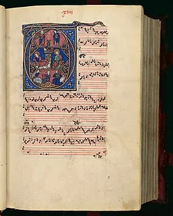

# 2.7 — Léonin y Pérotin

[⬅ volver al índice del curso](../../README.md)

**Objetivo:** conocer a las dos figuras centrales de la escuela de Notre Dame y entender por qué
su trabajo marca el nacimiento de la polifonía como arte compositivo deliberado.

## Quiénes eran (lo poco que se sabe con certeza)

A diferencia de Hildegard de Bingen, de quien tenemos datos biográficos razonablemente ricos,
de Léonin y Pérotin sabemos muy poco de forma directa: ningún documento de la época nos da fechas
de nacimiento o muerte precisas, ni detalles de su vida personal. Lo que sabemos de ellos viene
casi en su totalidad de un único testigo: un estudiante inglés anónimo que estudió en París a
fines del siglo XIII y que escribió un tratado (hoy conocido como el del "Anónimo IV") describiendo
el trabajo de ambos compositores, a quienes llama "el mejor compositor de organum" (a Léonin) y
"el mejor compositor de discantus" (a Pérotin), trabajando ambos en la catedral de Notre Dame de
París.

Se estima que Léonin trabajó activamente entre 1150 y 1201 aproximadamente, y Pérotin lo sucedió,
activo entre finales del siglo XII y las primeras décadas del XIII. Son, en los hechos, las dos
primeras figuras de la historia de la música europea cuyo **estilo compositivo individual** fue
reconocido y comentado explícitamente por un contemporáneo, aunque no tengamos biografías
detalladas de sus vidas personales.

## La obra de Léonin: el "Magnus Liber Organi"

A Léonin se le atribuye la compilación (y probablemente buena parte de la composición) del
"Magnus Liber Organi" ("El Gran Libro de Organum"), una colección sistemática de piezas de organum
(lección 2.4) para cubrir toda la liturgia del año en la catedral de Notre Dame. Es un hito
organizativo comparable, en su propio terreno, a lo que hizo Carlomagno con el canto gregoriano
(lección 2.5): por primera vez, alguien compila de forma sistemática y ambiciosa un repertorio
polifónico completo pensado para cubrir todo un calendario litúrgico, no solo piezas sueltas para
ocasiones específicas.

**Cómo suena:** el estilo de Léonin se caracteriza por el "organum sustentado" (también llamado
organum purum): una voz inferior (el "tenor", que viene del latín "tenere", sostener) canta las
notas del canto gregoriano original muy lentamente, estiradas en el tiempo casi como un bordón,
mientras una voz superior (el "duplum") teje una línea melódica mucho más rápida, florida y libre
por encima. El contraste entre la lentitud de la voz de abajo y la agilidad de la voz de arriba es
la característica sonora definitoria de este estilo.

## La obra de Pérotin: el discantus y el organum a 3 y 4 voces

Pérotin toma el "Magnus Liber Organi" de Léonin y lo revisa y amplía, introduciendo dos
innovaciones fundamentales. La primera es el "discantus" (contrapunto nota contra nota, donde las
dos voces se mueven con ritmos parecidos y coordinados entre sí, en lugar del contraste lento/rápido
del organum sustentado de Léonin). La segunda, todavía más audaz para su época: Pérotin compuso
organa a **tres y hasta cuatro voces simultáneas**, algo sin precedentes documentados hasta
entonces en la música europea. Sus obras "Viderunt omnes" y "Sederunt principes" (ambas a cuatro
voces) son consideradas, junto con el "Ordo Virtutum" de Hildegard, piezas fundacionales en la
historia de la polifonía occidental.

**Cómo suena:** una textura mucho más densa y compleja que el organum de Léonin, con varias voces
entrelazándose de forma intrincada, generando momentos de gran riqueza armónica (aunque todavía
regida por reglas muy distintas a las de la armonía tonal que vas a estudiar en el Barroco y el
Clasicismo: acá el criterio de qué combinaciones de notas "suenan bien" juntas está basado en los
intervalos consonantes de la tradición pitagórica, octavas, quintas y cuartas, no en acordes
completos como los que vas a conocer más adelante).

## Por qué son importantes juntos

Léonin y Pérotin representan, en secuencia, el paso de la polifonía como técnica de ornamentación
del canto gregoriano a la polifonía como arte compositivo complejo y deliberado, con una identidad
estilística propia que un contemporáneo (el Anónimo IV) pudo describir, comparar y valorar
explícitamente. Son, en ese sentido, el eslabón que conecta el organum más simple de los siglos IX
y X con la complejidad del Ars Nova del siglo XIV que vas a ver con Guillaume de Machaut en la
próxima lección.

## Preguntas de repaso

1. ¿Por qué sabemos tan poco, en términos biográficos, de Léonin y Pérotin, a pesar de que son
   figuras tan importantes?
2. ¿Qué es el "Magnus Liber Organi" y por qué se lo considera un hito organizativo?
3. ¿En qué consiste el "organum sustentado" (organum purum) característico del estilo de Léonin?
4. ¿Qué dos innovaciones introdujo Pérotin respecto del estilo de Léonin?
5. ¿Por qué "Viderunt omnes" y "Sederunt principes" son obras tan significativas en la historia de
   la polifonía?

### Respuestas

1. Porque casi todo lo que sabemos de ellos proviene de un único testigo indirecto: un estudiante
   inglés anónimo (conocido como el "Anónimo IV") que, a fines del siglo XIII, escribió un tratado
   describiendo su trabajo y su estilo compositivo. No existe ningún documento de la época que dé
   fechas de nacimiento o muerte precisas, ni detalles de sus vidas personales.
2. Es una colección sistemática de piezas de organum compilada (y probablemente compuesta en gran
   parte) por Léonin, pensada para cubrir toda la liturgia del año en la catedral de Notre Dame. Se
   lo considera un hito organizativo porque es la primera vez que alguien compila de forma
   sistemática y ambiciosa un repertorio polifónico completo para todo un calendario litúrgico, no
   solo piezas sueltas para ocasiones puntuales.
3. Consiste en que una voz inferior (el tenor) canta las notas del canto gregoriano original muy
   lentamente, estiradas en el tiempo casi como un bordón sostenido, mientras una voz superior (el
   duplum) teje por encima una línea melódica mucho más rápida, florida y libre. El contraste entre
   esa lentitud y esa agilidad es la característica sonora definitoria del estilo.
4. Introdujo el "discantus" (contrapunto nota contra nota, con las dos voces moviéndose con ritmos
   parecidos y coordinados, a diferencia del contraste lento/rápido de Léonin) y la composición de
   organa a tres y hasta cuatro voces simultáneas, algo sin precedentes documentados hasta
   entonces en la música europea.
5. Porque son de las primeras obras documentadas de la historia de la música occidental escritas a
   cuatro voces simultáneas, un nivel de complejidad polifónica sin precedentes para su época, lo
   que las convierte, junto con el "Ordo Virtutum" de Hildegard de Bingen, en piezas fundacionales
   de la polifonía occidental.
