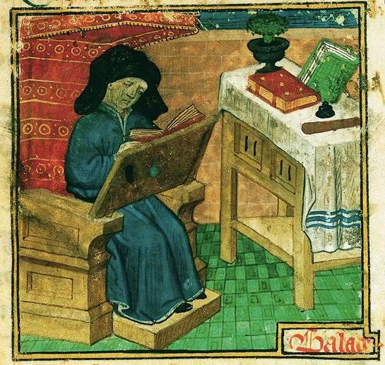

# 2.8 — Guillaume de Machaut

[⬅ volver al índice del curso](../../README.md)

**Objetivo:** conocer la vida y la obra de Guillaume de Machaut, la figura central del Ars Nova y
el primer compositor europeo del que tenemos una biografía detallada y un archivo de obra casi
completo supervisado por él mismo.

## Vida

Guillaume de Machaut nació alrededor de 1300 en la región de Champaña, en el noreste de Francia
(probablemente en la ciudad de Machault, de donde toma su apellido), y murió en 1377 en la ciudad
de Reims, donde pasó buena parte de su vida adulta como canónigo (un cargo eclesiástico
administrativo) de la catedral. A diferencia de Léonin y Pérotin, Machaut tuvo una carrera
documentada con mucho detalle: sirvió como secretario y luego como consejero cercano del rey Juan
de Bohemia (un noble aventurero que murió en 1346 en la batalla de Crécy, durante la Guerra de los
Cien Años entre Francia e Inglaterra, cargando ciego a la batalla por lealtad caballeresca,
atado a su caballo entre dos de sus caballeros), y luego de otros nobles de la corte francesa,
incluido el futuro rey Carlos V de Francia.

Machaut vivió, además, la peste negra (lección 2.5) en primera persona, en 1349, y la describió en
uno de sus poemas largos ("Le Jugement du Roy de Navarre") con un relato directo y perturbador de
la devastación que vio. Esa experiencia, junto con la inestabilidad política constante de la
Guerra de los Cien Años que marcó toda su vida adulta, le da a parte de su obra un tono introspectivo
y melancólico que contrasta con la elegancia cortesana de otros de sus textos.

## Obra

Machaut es, de lejos, el compositor más prolífico e influyente del Ars Nova francés (lección
2.5), y tiene un mérito adicional poco común para su época: él mismo supervisó, en vida, la
compilación de manuscritos con (casi) toda su obra completa, ordenada y catalogada, algo que
ningún compositor anterior había hecho de forma tan sistemática. Gracias a eso, tenemos un
panorama excepcionalmente completo de su producción.

Su obra más célebre y de mayor peso histórico es la **"Messe de Nostre Dame"** ("Misa de Nuestra
Señora"), compuesta probablemente alrededor de 1360-1365: es la primera misa polifónica completa
de la historia de la música occidental compuesta por un único autor identificado como un todo
coherente (hasta entonces, las distintas partes de la misa que se musicalizaban en polifonía se
componían por separado, por distintos compositores, sin una unidad de concepción). Está compuesta
a cuatro voces, con una textura rítmica y armónica mucho más elaborada que el organum de la escuela
de Notre Dame, usando las nuevas posibilidades de notación mensural y de subdivisión rítmica del
Ars Nova (lección 2.4 y 2.5).

Machaut también fue uno de los grandes poetas de su época (no solo compositor: en la tradición
medieval francesa, poesía y música cortesana estaban profundamente entrelazadas) y compuso un
enorme catálogo de canciones profanas de amor cortés en formas fijas francesas: el "virelai", el
"rondeau" y la "ballade", formas poético-musicales con estructuras de repetición específicas que
van a influir en la canción francesa durante los siglos siguientes. Su canción "Ma fin est mon
commencement" ("Mi fin es mi comienzo") es un ejemplo célebre de virtuosismo técnico: la melodía de
una de las voces es literalmente la misma melodía de otra voz pero tocada al revés (un palíndromo
musical), una proeza de construcción formal que refleja el tipo de juego intelectual que la
aristocracia de su época valoraba enormemente en el arte.

**Cómo suena su música:** comparada con el organum de Notre Dame, la música de Machaut suena más
"movida" rítmicamente (gracias a la notación mensural del Ars Nova), con texturas a tres o cuatro
voces donde cada voz tiene más independencia rítmica entre sí, y con una sensación armónica algo
más rica aunque todavía lejana de la armonía tonal moderna.

## Por qué es importante

Machaut es, en varios sentidos, la primera figura de este curso que se parece a lo que vamos a
entender por "compositor" en las fases siguientes: una persona con una biografía documentada en
detalle, que compone de forma consciente tanto música sacra como profana, que supervisa
personalmente la conservación de su propia obra completa, y cuya identidad creativa individual (su
estilo, sus innovaciones técnicas, su virtuosismo) es reconocida y valorada explícitamente por sus
contemporáneos, no solo por historiadores posteriores. Marca, de una manera muy concreta, el final
del anonimato casi total de la Fase 1 y buena parte de la Fase 2, y el comienzo de un modelo de
autoría individual que va a definir el resto de la historia de la música occidental.

## Preguntas de repaso

1. ¿Qué cargo tuvo Machaut en la corte francesa antes de establecerse como canónigo en Reims?
2. ¿Qué experiencia histórica traumática vivió Machaut en 1349 y cómo la documentó?
3. ¿Por qué la "Messe de Nostre Dame" es considerada un hito tan importante en la historia de la
   música?
4. ¿Qué tiene de especial, desde el punto de vista técnico, la canción "Ma fin est mon
   commencement"?
5. ¿Por qué se dice que Machaut se parece más a la idea moderna de "compositor" que cualquier
   figura anterior de este curso?

### Respuestas

1. Sirvió como secretario y luego consejero cercano del rey Juan de Bohemia, y más tarde de otros
   nobles de la corte francesa, incluido el futuro rey Carlos V de Francia, antes de establecerse
   como canónigo (cargo eclesiástico administrativo) en la catedral de Reims.
2. Vivió la peste negra de 1349 en primera persona y la describió con un relato directo de la
   devastación que vio en uno de sus poemas largos, "Le Jugement du Roy de Navarre", lo que le da a
   parte de su obra un tono introspectivo y melancólico ligado a esa experiencia.
3. Porque es la primera misa polifónica completa de la historia de la música occidental compuesta
   por un único autor identificado, concebida como una unidad coherente: hasta entonces, las
   distintas partes de la misa que se musicalizaban en polifonía se componían por separado, por
   distintos compositores, sin una unidad de concepción conjunta.
4. La melodía de una de sus voces es literalmente la misma melodía de otra voz pero tocada al
   revés, un palíndromo musical: una proeza de construcción formal que demuestra el tipo de juego
   intelectual y virtuosismo técnico que la aristocracia de su época valoraba en el arte.
5. Porque tenemos una biografía suya documentada en detalle, compuso de forma consciente tanto
   música sacra como profana, supervisó personalmente la compilación y conservación de casi toda su
   obra completa en vida, y su identidad creativa individual fue reconocida y valorada
   explícitamente por sus contemporáneos, a diferencia del anonimato casi total de las figuras
   anteriores de este curso.
