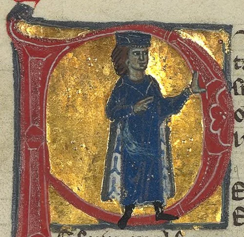
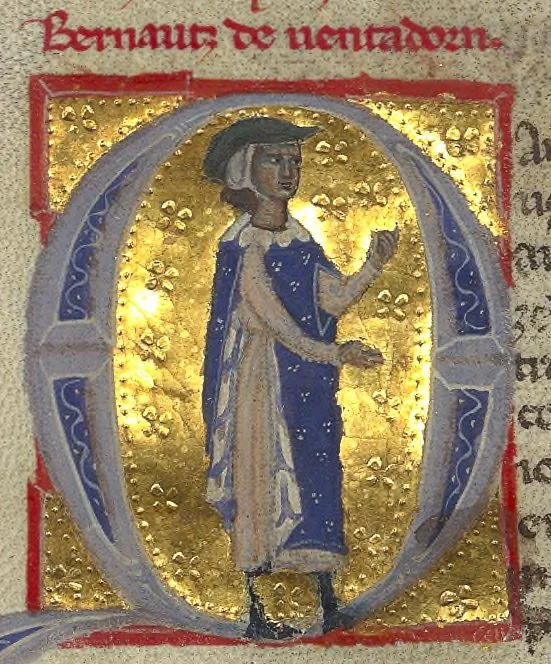
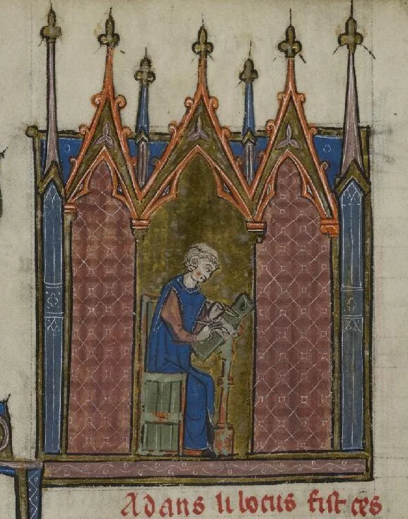

# 2.9 — Figuras menores

[⬅ volver al índice del curso](../../README.md)

**Objetivo:** conocer a los trovadores y troveros, la gran tradición musical profana medieval en
paralelo a la música religiosa, con una reseña breve de sus figuras principales.

## Quiénes eran los trovadores

Mientras la música religiosa se desarrollaba en latín dentro de catedrales y monasterios (lecciones
2.3 a 2.8), floreció en paralelo, a partir del siglo XI, una tradición musical profana (es decir,
no religiosa) en lenguas vernáculas (las lenguas que la gente hablaba en su vida diaria, no el
latín): el "occitano" (la lengua del sur de Francia) en el caso de los **trovadores**, y el
francés del norte en el caso de los **troveros** ("trouvères"). Cantaban, en su mayoría, sobre el
"amor cortés": un código poético-romántico idealizado donde un caballero expresa una devoción casi
religiosa por una dama (a menudo casada, a menudo inalcanzable), cargado de un vocabulario de
servicio, sufrimiento y devoción muy codificado, que va a influir en la literatura amorosa europea
durante siglos.

A diferencia de los compositores religiosos, muchos trovadores eran ellos mismos nobles (incluso
de muy alto rango) que componían como parte de su cultura cortesana, aunque también había
trovadores de origen humilde que lograban prestigio solo por su talento. La música se transmitía
sobre todo de forma oral, acompañada de laúd o vihuela de rueda (lección 2.2), y recién a partir
del siglo XII empieza a anotarse con cierta regularidad en manuscritos llamados "chansonniers"
(cancioneros).

## Guillermo de Aquitania (1071-1126)

Duque de Aquitania y uno de los nobles más poderosos de Francia en su época (su nieta fue la
célebre Leonor de Aquitania, reina de Francia y luego de Inglaterra), es considerado el primer
trovador conocido por nombre. De su obra sobreviven solo once poemas (sin notación musical
conservada, lamentablemente), con un tono que va de lo abiertamente erótico y hasta obsceno hasta
la reflexión filosófica sobre la vejez y la muerte, lo que muestra que la poesía trovadoresca, ya
desde su figura fundacional, no era un género de un solo registro emocional.

## Bernart de Ventadorn (activo h. 1147-1170)

De origen humilde (algunas fuentes medievales, probablemente legendarias, dicen que era hijo de un
panadero o de un sirviente del castillo de Ventadorn), es considerado el trovador más influyente
desde el punto de vista poético y musical de su generación, con 45 poemas conservados (18 de ellos
con su melodía original). Su canción "Can vei la lauzeta mover" ("Cuando veo a la alondra moverse")
es una de las piezas más estudiadas del repertorio trovadoresco, con una melodía fluida que
acompaña una reflexión sobre el amor no correspondido.

## Adam de la Halle (h. 1245-1288)

Trovero del norte de Francia (de Arras), es una figura de transición importante porque, además de
canciones monofónicas en la tradición trovadoresca clásica, compuso también una de las primeras
obras de teatro musical profano de la historia europea, "Le Jeu de Robin et Marion" ("El juego de
Robin y Marion"), una pieza pastoral con diálogo cantado que se considera un antecedente lejano de
la ópera comique y del teatro musical popular. También experimentó con la polifonía (algo poco
común entre trovadores y troveros, que en su mayoría escribían música monofónica), lo que muestra
la influencia cruzada entre la tradición cortesana profana y las técnicas desarrolladas en paralelo
por la escuela de Notre Dame.

## Por qué importan juntos

Los trovadores y troveros representan la gran tradición musical profana de la Edad Media, en una
época donde la mayor parte de lo que se conservó por escrito fue religioso. Su existencia nos
recuerda que la música medieval no era solo canto gregoriano y polifonía sacra: había todo un
universo de canción de amor, entretenimiento cortesano y, con Adam de la Halle, incluso teatro
musical profano, que compartía el escenario cultural con la música de la Iglesia sin depender
directamente de ella.

## Preguntas de repaso

1. ¿Qué diferencia principal hay entre un "trovador" y un "trovero"?
2. ¿Qué es el "amor cortés" y qué rol juega en la poesía trovadoresca?
3. ¿Por qué Guillermo de Aquitania es una figura fundacional pese a que no sobrevivió ninguna
   melodía suya?
4. ¿Qué logró Adam de la Halle que lo distingue de la mayoría de los trovadores y troveros?

### Respuestas

1. La diferencia principal es la lengua: los trovadores cantaban en occitano, la lengua del sur de
   Francia, mientras que los troveros ("trouvères") cantaban en francés del norte. Ambas
   tradiciones comparten temática y estilo (el amor cortés) pero se distinguen geográfica y
   lingüísticamente.
2. Es un código poético-romántico idealizado donde un caballero expresa una devoción casi
   religiosa por una dama, a menudo casada o inalcanzable, usando un vocabulario de servicio,
   sufrimiento y devoción muy codificado. Es el tema central de la inmensa mayoría de la poesía
   trovadoresca y va a influir en la literatura amorosa europea durante siglos.
3. Porque es la primera figura identificada por nombre dentro de esta tradición: aunque de su obra
   solo sobreviven once poemas sin su notación musical original, el hecho de ser el primer
   trovador conocido lo convierte en el punto de partida documentado de todo el movimiento
   trovadoresco posterior.
4. Compuso una de las primeras obras de teatro musical profano de la historia europea ("Le Jeu de
   Robin et Marion"), con diálogo cantado, y además experimentó con la polifonía, algo poco común
   entre trovadores y troveros, que en su mayoría escribían música monofónica. Esto lo convierte en
   una figura de transición entre la tradición cortesana clásica y las técnicas más complejas
   desarrolladas en paralelo por compositores como Léonin y Pérotin.

[⬅ volver al índice del curso](../../README.md)
