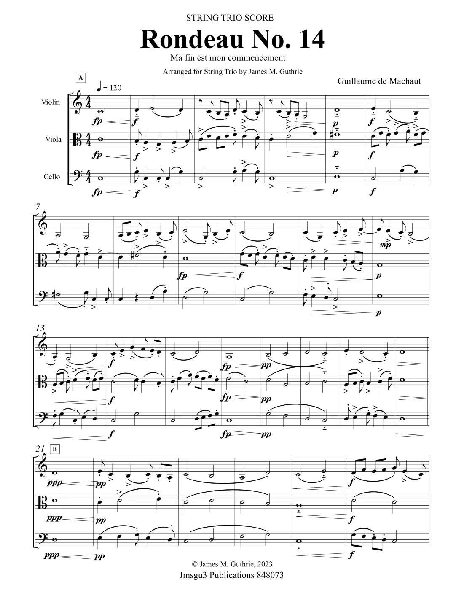

# 2.10 — Obras clave y guía de escucha

[⬅ volver al índice del curso](../../README.md)

**Objetivo:** tener una lista concreta de piezas para escuchar y anclar todo lo visto en esta fase
a sonido real, en este caso grabaciones de buena calidad (no solo reconstrucciones hipotéticas como
en la Fase 1).

## Cómo usar esta guía

A diferencia de la Fase 1, para la música medieval sí existen grabaciones excelentes y
ampliamente disponibles de intérpretes especializados en música antigua (grupos como Sequentia,
The Hilliard Ensemble, Anonymous 4, Ensemble Organum), porque la notación medieval, sobre todo
desde Guido d'Arezzo, es mucho más precisa y confiable que la de Mesopotamia o Grecia.

## 1. "Dies irae" (canto gregoriano tradicional)

Buscá cualquier grabación de monjes benedictinos cantando este himno (hay muchísimas disponibles).
Es uno de los cantos gregorianos más famosos y reconocibles del repertorio (lo vas a reconocer
también porque su melodía fue citada por compositores mucho más tardíos, como Berlioz o
Rachmaninoff, en la música romántica y del siglo XX). Escuchalo prestando atención a la monofonía
pura (lección 2.3): una sola línea melódica, sin instrumentos, en latín, sin pulso rítmico fijo.

## 2. "Viderunt omnes" de Pérotin

Buscá "Pérotin Viderunt omnes" interpretado por el Hilliard Ensemble o Sequentia. Es una obra a
cuatro voces (lección 2.7) y te va a permitir escuchar con claridad la diferencia entre la densidad
sonora de la polifonía plena de Notre Dame y la monofonía del canto gregoriano del punto anterior.
Prestá atención al tenor (la voz grave que sostiene las notas largas del canto original) contra las
voces superiores, más ágiles.

## 3. "O virtus Sapientiae" de Hildegard de Bingen

Buscá cualquier grabación de esta pieza (o de "O vis aeternitatis", también muy grabada), ambas
del ciclo "Symphonia" (lección 2.6). Comparala con el "Dies irae" del punto 1: notá los saltos
melódicos más amplios y el carácter más extático de la música de Hildegard, incluso dentro de la
monofonía compartida con el canto gregoriano estándar.

## 4. "Messe de Nostre Dame" de Guillaume de Machaut

Buscá "Machaut Messe de Nostre Dame" interpretada por el Hilliard Ensemble o por Diabolus in
Musica. Es la obra central de la lección 2.8: escuchá cómo la textura a cuatro voces del Ars Nova
se siente rítmicamente más "movida" y compleja que el organum de Pérotin, gracias a la notación
mensural.

## 5. "Can vei la lauzeta mover" de Bernart de Ventadorn

Buscá esta canción interpretada con laúd o vihuela de rueda. Es la pieza trovadoresca más famosa
de las que tienen melodía conservada (lección 2.9): escuchá cómo, al ser música profana y
monofónica con acompañamiento instrumental, suena mucho más cercana a lo que hoy asociaríamos con
"una canción" que el canto gregoriano litúrgico.

## 6. "Ma fin est mon commencement" de Guillaume de Machaut

Buscá esta pieza en particular, aparte de la Messe. Escuchala prestando atención (si podés leer un
poco sobre su estructura mientras escuchás) al truco del palíndromo musical descrito en la lección
2.8: es un ejercicio auditivo fascinante incluso sin entender la teoría en detalle.

## Tabla resumen

| Obra | Autor/tradición | Qué escuchar |
|---|---|---|
| Dies irae | canto gregoriano anónimo | monofonía pura, sin instrumentos |
| Viderunt omnes | Pérotin | polifonía a 4 voces, tenor sostenido contra voces ágiles |
| O virtus Sapientiae | Hildegard de Bingen | monofonía con saltos melódicos amplios y carácter extático |
| Messe de Nostre Dame | Guillaume de Machaut | polifonía del Ars Nova, rítmicamente más compleja |
| Can vei la lauzeta mover | Bernart de Ventadorn | canción trovadoresca profana con acompañamiento |
| Ma fin est mon commencement | Guillaume de Machaut | palíndromo musical, virtuosismo formal |

## Preguntas de repaso

1. ¿Por qué en esta fase ya se pueden conseguir grabaciones de alta calidad, a diferencia de la
   Fase 1?
2. ¿Qué diferencia concreta deberías notar al comparar el "Dies irae" con "Viderunt omnes" de
   Pérotin?
3. ¿Qué deberías notar al comparar "O virtus Sapientiae" de Hildegard con el canto gregoriano
   estándar?
4. ¿Por qué "Can vei la lauzeta mover" suena, a un oído moderno, más cercana a "una canción" que el
   canto gregoriano litúrgico?

### Respuestas

1. Porque la notación musical medieval, sobre todo a partir del sistema de líneas de Guido
   d'Arezzo, fija con precisión la altura exacta de cada nota (y, desde el siglo XIII en adelante,
   también su duración), lo que permite a los intérpretes de hoy reconstruir estas piezas con un
   grado de fidelidad mucho mayor que el de las reconstrucciones hipotéticas de la música de
   Mesopotamia o Grecia.
2. La diferencia principal es la textura: el "Dies irae" es monofonía pura, una sola línea
   melódica sin instrumentos. "Viderunt omnes" es polifonía a cuatro voces, con un tenor grave que
   sostiene notas largas del canto original mientras voces superiores más ágiles tejen líneas
   melódicas por encima, generando una densidad sonora mucho mayor.
3. Deberías notar que, aunque ambas son música monofónica en latín sin instrumentos, la pieza de
   Hildegard tiene saltos melódicos más amplios y un carácter más intenso y extático que el canto
   gregoriano estándar, consistente con la naturaleza visionaria de sus textos.
4. Porque es música profana (no litúrgica), monofónica pero con acompañamiento instrumental (laúd o
   vihuela de rueda), centrada en un tema humano y emocional (el amor no correspondido) en lugar de
   un texto sagrado en latín, lo que la acerca mucho más, en espíritu, a lo que hoy entendemos como
   una canción.
