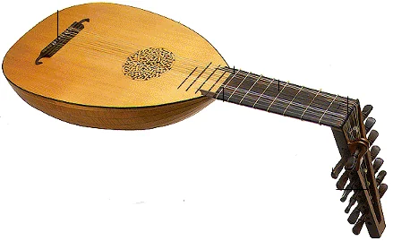
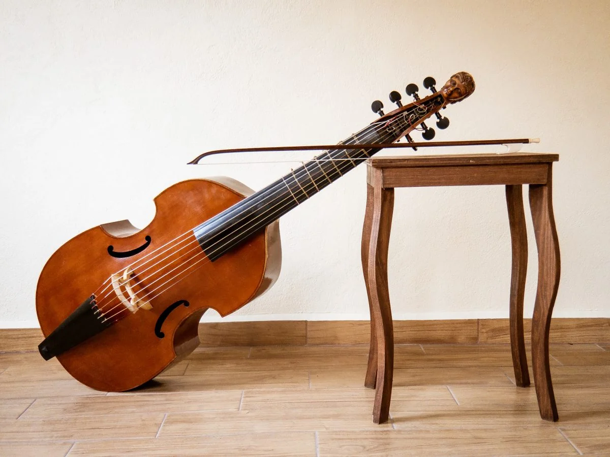
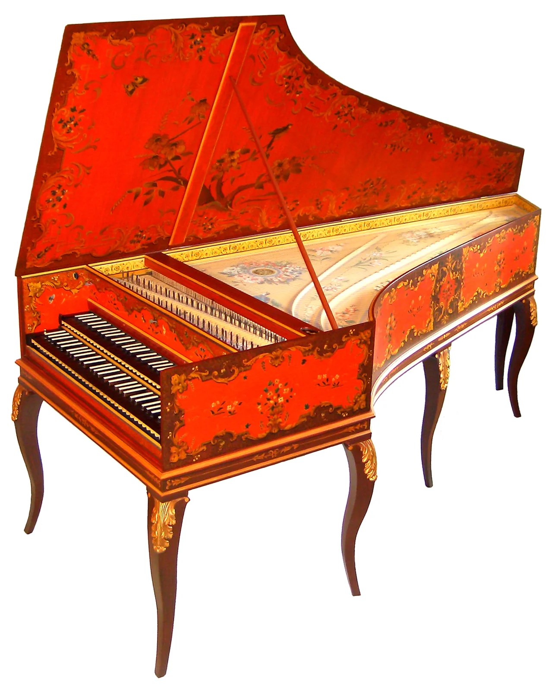
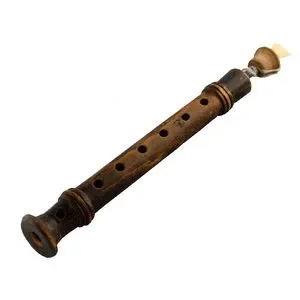

# 3.2 — Instrumentos del Renacimiento

[⬅ volver al índice del curso](../../README.md)

**Objetivo:** conocer los instrumentos principales del Renacimiento, su construcción y su estética
sonora, explicado para quien no sabe de música.

## El laúd renacentista

El laúd (ya presentado en su versión medieval en la lección 2.2) alcanza en el Renacimiento su
máximo refinamiento y popularidad: se vuelve el instrumento solista más importante de Europa,
comparable en prestigio a lo que el piano va a ser en el siglo XIX. Tiene entre 6 y 10 cuerdas
(organizadas en pares llamados "órdenes", salvo la más aguda), un mástil con trastes de tripa
atados (no fijos como en una guitarra moderna) y una caja de resonancia en forma de media pera,
muy liviana. Se tocaba con los dedos (no con púa), permitiendo tocar varias voces (una melodía y su
acompañamiento) al mismo tiempo con un solo instrumento, algo nuevo e importante: antes, para tener
una melodía con acompañamiento armónico, hacían falta dos músicos.

**Cómo suena:** un sonido íntimo, cálido, con buena capacidad de sostener varias voces a la vez
pero con poco volumen (ideal para una sala pequeña o una cámara privada, no para un espacio grande
como una catedral).

## La viola da gamba

Instrumento de cuerda frotada con arco (no pulsada como el laúd), que se sostiene entre las piernas
del músico, sentado (de ahí el nombre: "gamba" significa "pierna" en italiano). Tiene trastes,
como el laúd, y entre 5 y 7 cuerdas. Existía en varios tamaños, desde la soprano más chica hasta el
contrabajo, formando "consorts" (conjuntos de violas de distinto tamaño tocando juntas, como un
cuarteto de cuerdas pero todas de la misma familia de instrumento).

**Cómo suena:** un timbre suave, nasal y algo velado comparado con el violín que lo va a reemplazar
en popularidad en el Barroco; es un sonido muy valorado hoy por los especialistas en música
antigua justamente por esa calidez discreta.

## El clavicémbalo

Es el antepasado directo del piano, pero funciona de forma muy distinta: en vez de un martillo que
golpea la cuerda (como en el piano), el clavicémbalo usa un mecanismo de teclas que, al presionarse,
hace que una pequeña púa (originalmente de pluma de ave) **pulse** la cuerda, como si alguien la
rasgara con una uña. Esto tiene una consecuencia sonora importante: no se puede controlar el
volumen de una nota apretando la tecla más fuerte o más suave (a diferencia del piano), porque la
púa siempre pulsa con la misma fuerza sea como sea que se presione la tecla.

**Cómo suena:** un sonido brillante, metálico, percusivo y de decaimiento relativamente rápido (la
nota no se sostiene tanto como en un órgano), con una identidad tímbrica inconfundible que lo
distingue claramente del piano.

## La chirimía y la familia de los ministriles

La chirimía es un instrumento de viento con lengüeta doble (como el aulos griego de la Fase 1 y
como el oboe moderno), de sonido fuerte y penetrante, pensado para tocar al aire libre en
procesiones y ceremonias públicas. Junto con la sacabuche (un instrumento de metal con vara
corredera, el antepasado directo del trombón) formaba los "consorts de ministriles": conjuntos de
viento contratados por las ciudades para tocar en ocasiones oficiales, bodas, recepciones de
visitantes importantes.

**Cómo suena:** brillante y potente, capaz de proyectarse al aire libre sin perder definición, muy
distinto del sonido íntimo del laúd o la viola da gamba, pensados para espacios cerrados.

## El órgano renacentista

El órgano (ya presentado en su forma medieval en la lección 2.2) se vuelve, durante el
Renacimiento, un instrumento mucho más sofisticado: se le agregan varios "registros" (mecanismos
que permiten elegir entre distintos tipos de tubos, cada uno con un timbre distinto, como elegir
entre varios instrumentos virtuales dentro de uno solo) y se vuelve el instrumento central no solo
de la liturgia sino también de un nuevo género musical escrito específicamente para teclado.

**Cómo suena:** mucho más variado tímbricamente que el órgano medieval, gracias a la posibilidad de
combinar registros para lograr sonoridades distintas, desde timbres suaves y flautados hasta
combinaciones brillantes y potentes.

## Tabla resumen de estética sonora

| Instrumento | Familia | Sonido en una frase |
|---|---|---|
| Laúd | cuerda (pulsada) | íntimo, cálido, capaz de tocar varias voces a la vez |
| Viola da gamba | cuerda (frotada) | suave, nasal, velado |
| Clavicémbalo | cuerda (pulsada por teclado) | brillante, metálico, percusivo |
| Chirimía | viento (lengüeta doble) | fuerte, penetrante, para exteriores |
| Órgano renacentista | viento (mecánico) | variado, según el registro elegido |

## Preguntas de repaso

1. ¿Qué cambia en el laúd del Renacimiento respecto del laúd medieval en términos de su rol
   musical?
2. ¿En qué se diferencia físicamente la viola da gamba del violín que la va a reemplazar en
   popularidad en el Barroco?
3. ¿Por qué el clavicémbalo no puede variar el volumen de una nota apretando la tecla con más o
   menos fuerza?
4. ¿Para qué se usaban los "consorts de ministriles" y por qué necesitaban instrumentos como la
   chirimía en vez de, por ejemplo, un laúd?
5. ¿Qué son los "registros" de un órgano renacentista y qué le permiten hacer al instrumento?

### Respuestas

1. Se vuelve el instrumento solista más importante de Europa, capaz de tocar al mismo tiempo una
   melodía y su acompañamiento armónico con un solo músico, algo que antes requería dos personas
   tocando juntas.
2. La viola da gamba se toca con un arco (es una cuerda frotada) y se sostiene entre las piernas
   del músico sentado, mientras que el violín (que la va a reemplazar en popularidad) tiene una
   construcción y una forma de sostenerse distintas y, sobre todo, un sonido más brillante y
   proyectado, mejor adaptado a espacios grandes y a la música orquestal que viene en el Barroco.
3. Porque el mecanismo del clavicémbalo usa una pequeña púa que pulsa la cuerda siempre con la
   misma fuerza, sin importar cómo se presione la tecla, a diferencia del piano, donde un martillo
   golpea la cuerda con una fuerza proporcional a la presión del dedo.
4. Se usaban para tocar al aire libre en procesiones, ceremonias públicas, bodas y recepciones de
   visitantes importantes, contextos donde se necesitaba un sonido fuerte y penetrante capaz de
   proyectarse sin perder definición; un laúd, de sonido íntimo y de bajo volumen, sería inaudible
   en esos contextos.
5. Son mecanismos que permiten elegir entre distintos tipos de tubos, cada uno con un timbre
   distinto, dentro del mismo instrumento. Le permiten al organista combinar sonoridades para lograr
   timbres muy variados, desde sonidos suaves y flautados hasta combinaciones brillantes y
   potentes, en lugar de tener siempre el mismo timbre fijo.

[⬅ volver al índice del curso](../../README.md)
