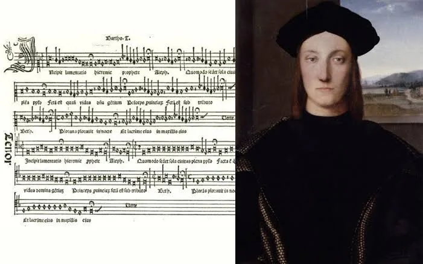

# 3.4 — Hitos importantes

[⬅ volver al índice del curso](../../README.md)

**Objetivo:** repasar los hitos concretos que marcan el Renacimiento musical, con el contexto de
cada uno.

## La imprenta musical de Ottaviano Petrucci (1501)

En 1501, en Venecia, el impresor Ottaviano Petrucci publica el "Harmonice Musices Odhecaton", la
primera colección de música polifónica impresa con tipos móviles de la historia (una técnica mucho
más compleja que imprimir texto, porque hay que alinear con precisión notas, líneas de pentagrama y
texto). Antes de esto, cada copia de una partitura se hacía a mano, un proceso lento y caro que
limitaba enormemente cuánta música podía circular y a cuánta gente. La imprenta musical de Petrucci
(seguida pronto por otros impresores en toda Europa) multiplica de forma exponencial la cantidad de
música disponible, permite que un compositor en Roma vea con facilidad la obra de un compositor en
Flandes, y es, en los hechos, la "red de distribución musical" equivalente a lo que hoy sería una
plataforma de streaming: antes casi nadie podía acceder a una partitura salvo quien la copiara a
mano; después, cualquiera con dinero para comprar un libro impreso podía tener acceso al repertorio
de los mejores compositores de Europa.

## El Concilio de Trento y la reforma de la música sacra (1545-1563)

Convocado por la Iglesia católica como respuesta a la Reforma protestante (ver más abajo), el
Concilio de Trento discutió, entre muchísimos otros temas, el estado de la música sacra: algunos
obispos conservadores llegaron a proponer prohibir la polifonía por completo en la misa, porque
consideraban que la complejidad de las voces superpuestas hacía imposible entender el texto
litúrgico (volviendo, de hecho, a la vieja desconfianza de San Agustín hacia la música, lección
1.7). Finalmente no se prohibió la polifonía, pero se estableció como principio general que la
música sacra debía favorecer la claridad e inteligibilidad del texto. La tradición (hoy
cuestionada por los historiadores, pero muy influyente durante siglos) atribuye a Palestrina
(lección 3.7) el haber "salvado" a la polifonía de la prohibición con su "Misa del Papa Marcelo",
compuesta como ejemplo de que la polifonía sí podía ser clara.

## La Reforma protestante (1517 en adelante)

El monje agustino alemán Martín Lutero publica en 1517 sus 95 tesis, un acto que inicia la Reforma
protestante: una ruptura religiosa profunda con la Iglesia católica que va a dividir a Europa en
confesiones católicas y protestantes durante siglos. Para la música, la Reforma tiene un efecto
directo e importante: Lutero, a diferencia de muchos clérigos católicos conservadores, valoraba
enormemente la música y promovió activamente que la congregación entera (no solo el coro
profesional) cantara himnos en lengua vernácula (alemán, no latín) durante el servicio religioso.
Estos himnos, llamados "corales luteranos", muchos compuestos o adaptados por el propio Lutero, van
a convertirse en la base del repertorio protestante alemán, y Johann Sebastian Bach (lección 4.8),
casi dos siglos más tarde, va a construir buena parte de su obra sacra sobre estas mismas melodías.

## La caída del ducado de Borgoña y el ascenso de las cortes italianas y españolas (1477 en
adelante)

En 1477, el duque de Borgoña Carlos el Temerario muere en batalla sin heredero varón, y su
territorio se fragmenta entre Francia y los Habsburgo austríacos, lo que debilita a la corte
borgoñona como centro musical unificado (lección 3.1). En paralelo, durante el siglo XVI, las
cortes italianas (sobre todo Roma, con la Capilla Sixtina papal, y Venecia, con la Basílica de San
Marco) y la corte española de los Habsburgo (que, gracias a Carlos V, también gobernaba buena parte
de Europa y América) se consolidan como los nuevos grandes centros de mecenazgo musical,
desplazando el centro de gravedad musical europeo hacia el sur.

## La llegada de los europeos a América (1492 en adelante) y el primer contacto musical

El "descubrimiento" de América por Cristóbal Colón en 1492 y la colonización española y portuguesa
que siguió tuvieron, aunque de forma menos documentada que los hitos anteriores, una consecuencia
musical significativa: misioneros católicos (sobre todo jesuitas y franciscanos) llevaron la
polifonía renacentista europea a América como herramienta de evangelización, fundando escuelas de
música para enseñar a cantar y a tocar instrumentos europeos a la población indígena, mientras que,
en paralelo, elementos de la música indígena y africana (traída por el comercio de personas
esclavizadas) comenzaron a mezclarse con la tradición europea. Este proceso de mezcla, apenas
iniciado en el Renacimiento, va a ser una de las raíces de buena parte de la música popular
latinoamericana que vas a ver en fases mucho más avanzadas de este curso (el tango, lección 13).

## Preguntas de repaso

1. ¿Por qué la imprenta musical de Petrucci se puede comparar con una plataforma de streaming
   actual?
2. ¿Qué discutió el Concilio de Trento respecto de la polifonía, y qué se decidió finalmente?
3. ¿Qué efecto tuvo la Reforma protestante sobre la música, más allá de la ruptura religiosa en sí?
4. ¿Por qué se debilita la corte de Borgoña como centro musical a partir de 1477?
5. ¿Qué consecuencia musical tuvo la colonización europea de América a partir de 1492?

### Respuestas

1. Porque antes de la imprenta musical cada copia de una partitura se hacía a mano, un proceso
   lento y caro que limitaba enormemente cuánta música podía circular. La imprenta multiplicó de
   forma exponencial la cantidad de música disponible y permitió que cualquiera con dinero para
   comprar un libro impreso accediera al repertorio de los mejores compositores de Europa, de la
   misma forma en que una plataforma de streaming hoy da acceso masivo a música que antes requería
   comprar cada disco por separado.
2. Se discutió si prohibir por completo la polifonía en la misa, porque algunos obispos
   conservadores consideraban que la complejidad de las voces superpuestas hacía imposible entender
   el texto litúrgico. Finalmente no se prohibió, pero se estableció como principio general que la
   música sacra debía favorecer la claridad e inteligibilidad del texto.
3. Promovió que la congregación entera (no solo el coro profesional) cantara himnos en lengua
   vernácula durante el servicio religioso, los llamados "corales luteranos", que se convirtieron
   en la base del repertorio protestante alemán y que, casi dos siglos después, Johann Sebastian
   Bach iba a usar como material de buena parte de su obra sacra.
4. Porque el duque Carlos el Temerario muere en batalla en 1477 sin heredero varón, y su territorio
   se fragmenta entre Francia y los Habsburgo austríacos, lo que desarma la unidad política y, con
   ella, la capacidad de sostener una corte musical centralizada tan prestigiosa como la que había
   existido hasta entonces.
5. Misioneros católicos llevaron la polifonía renacentista europea a América como herramienta de
   evangelización, fundando escuelas de música para la población indígena, mientras que, en
   paralelo, elementos de la música indígena y de la música africana traída por el comercio de
   personas esclavizadas comenzaron a mezclarse con la tradición europea, un proceso que es una de
   las raíces de buena parte de la música popular latinoamericana posterior.

[⬅ volver al índice del curso](../../README.md)
