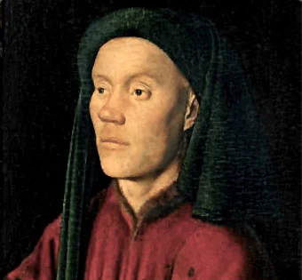

# 3.5 — Guillaume Dufay

[⬅ volver al índice del curso](../../README.md)

**Objetivo:** conocer la vida y la obra de Guillaume Dufay, la figura central del Renacimiento
temprano y el puente entre el Ars Nova medieval y la polifonía plenamente renacentista.

## Vida

Guillaume Dufay nació alrededor de 1397, probablemente cerca de Cambrai, en el norte de Francia, y
murió en 1474 en esa misma ciudad, donde pasó buena parte de su vida como canónigo de la catedral,
de forma muy parecida a como Machaut había sido canónigo en Reims (lección 2.8). Entre esos dos
extremos, Dufay tuvo una carrera internacional poco común para su época: trabajó para la corte
papal en Roma, viajó y trabajó en Italia (en Bologna, Florencia, donde presenció la inauguración de
la catedral de Florencia con su cúpula diseñada por Brunelleschi), y sirvió también a la poderosa
corte de los duques de Borgoña (lección 3.1), lo que lo puso en contacto con los principales
centros de poder musical de su tiempo, tanto italianos como del norte de Europa.

## Obra

Dufay compuso en prácticamente todos los géneros disponibles en su época: misas, motetes y canciones
profanas (sobre todo en las formas fijas francesas heredadas de la tradición de Machaut, como el
rondeau). Su motete "Nuper rosarum flores", compuesto para la consagración de la catedral de Santa
María del Fiore (la catedral de Florencia) en 1436, es una de sus obras más estudiadas: según una
teoría muy difundida entre musicólogos (aunque debatida), las proporciones rítmicas de sus
secciones estarían calculadas para reflejar las proporciones arquitectónicas de la cúpula de
Brunelleschi, un ejemplo fascinante (comprobado o no) de cómo el ideal humanista de proporción y
armonía (lección 3.1, y antes, Pitágoras en la lección 1.5) podía pensarse igual en la música y en
la arquitectura.

Dufay también fue pionero en un nuevo tipo de misa: la "misa de tenor cíclico", donde las cinco
partes de la liturgia comparten una misma melodía de base (el "tenor") tomada de un canto gregoriano
o de una canción profana, dándole unidad a toda la obra (el mismo principio que describimos de forma
general en la lección 3.3). Su "Missa Se la face ay pale", basada en una de sus propias canciones
profanas de amor, es un ejemplo célebre, y también un caso temprano de un compositor reutilizando su
propio material profano dentro de una obra sacra, algo que en siglos posteriores iba a generar
polémicas similares a las que vimos sobre el Concilio de Trento (lección 3.4).

**Cómo suena su música:** comparada con Machaut, la música de Dufay suena más suave y consonante,
con menos complejidad rítmica superpuesta y más atención a que las voces se combinen de forma
agradable entre sí, anticipando el ideal de equilibrio armónico que vas a escuchar plenamente
desarrollado en Josquin des Prez (lección 3.6) y Palestrina (lección 3.7).

## Por qué es importante

Dufay es considerado por la mayoría de los historiadores el compositor más influyente de la
primera mitad del siglo XV, y la figura que marca la transición definitiva entre la complejidad
rítmica y formal del Ars Nova (Machaut) y el nuevo ideal renacentista de consonancia fluida y
equilibrio sonoro. Su carrera internacional (Francia, Italia, Borgoña) también anticipa un patrón
que se va a repetir con muchos compositores renacentistas: el prestigio musical ya no depende de
quedarse en un único lugar, sino de circular entre las grandes cortes y catedrales de Europa,
siguiendo la demanda de mecenazgo que describimos en la lección 3.1.

## Preguntas de repaso

1. ¿En qué se parece la carrera eclesiástica de Dufay a la de Machaut?
2. ¿Qué tiene de especial el motete "Nuper rosarum flores" según la teoría más difundida sobre él?
3. ¿Qué es una "misa de tenor cíclico" y qué ejemplo da la lección sobre Dufay?
4. ¿Por qué se dice que la música de Dufay suena "más suave" que la de Machaut?
5. ¿Por qué se considera a Dufay una figura de transición tan importante en la historia de la
   música?

### Respuestas

1. Ambos pasaron buena parte de su vida adulta como canónigos de una catedral (Machaut en Reims,
   Dufay en Cambrai), un cargo eclesiástico administrativo que les daba una posición estable y
   prestigiosa dentro de la Iglesia mientras seguían componiendo.
2. Según esa teoría (difundida pero debatida entre musicólogos), las proporciones rítmicas de sus
   secciones estarían calculadas para reflejar las proporciones arquitectónicas de la cúpula de
   Brunelleschi en la catedral de Florencia, para cuya consagración se compuso la pieza en 1436,
   como un ejemplo de cómo el ideal humanista de proporción podía pensarse igual en la música y en
   la arquitectura.
3. Es un tipo de misa donde las cinco partes de la liturgia comparten una misma melodía de base (el
   "tenor"), tomada de un canto gregoriano o de una canción profana, lo que le da unidad a toda la
   obra. El ejemplo que da la lección es la "Missa Se la face ay pale", basada en una canción
   profana de amor compuesta por el propio Dufay.
4. Porque, comparada con la complejidad rítmica superpuesta de Machaut, la música de Dufay presta
   más atención a que las voces se combinen de forma agradable y consonante entre sí, anticipando
   el ideal de equilibrio armónico que se desarrolla plenamente con compositores posteriores como
   Josquin des Prez y Palestrina.
5. Porque marca la transición definitiva entre la complejidad formal del Ars Nova medieval y el
   nuevo ideal renacentista de consonancia fluida y equilibrio sonoro, y porque su carrera
   internacional (Francia, Italia, la corte de Borgoña) anticipa el patrón de circulación entre las
   grandes cortes europeas que va a caracterizar a los compositores renacentistas posteriores.
